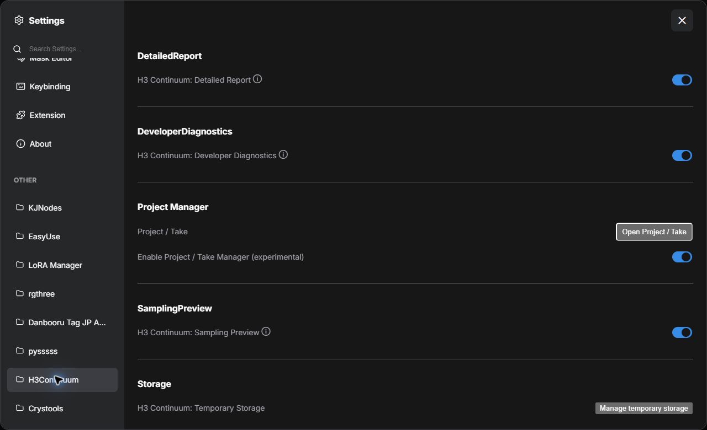
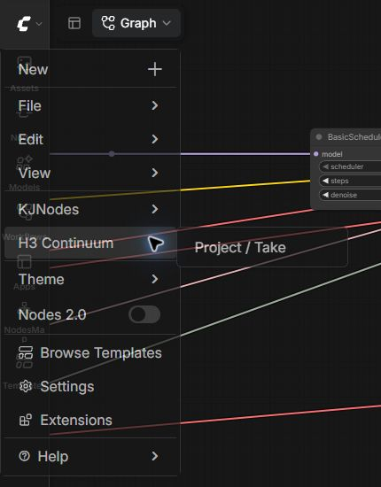
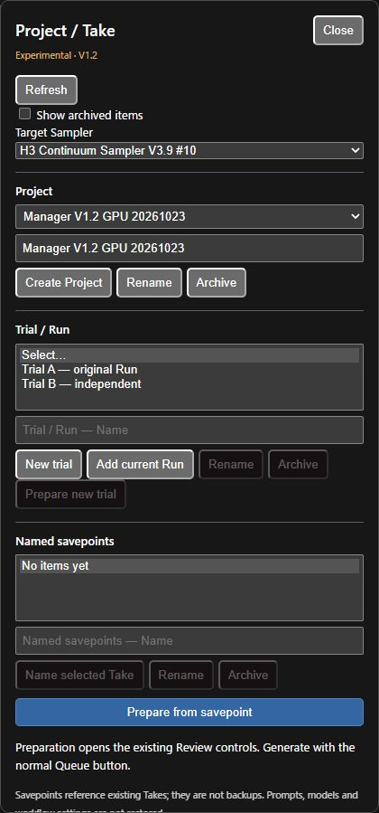
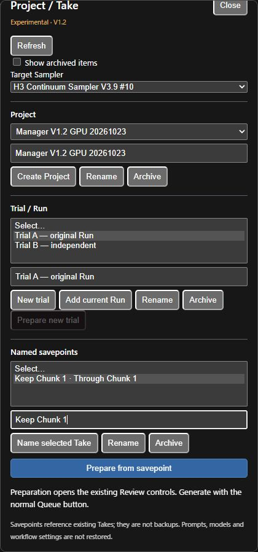
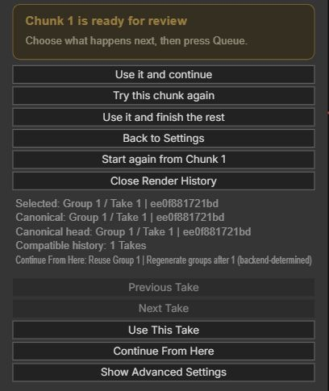
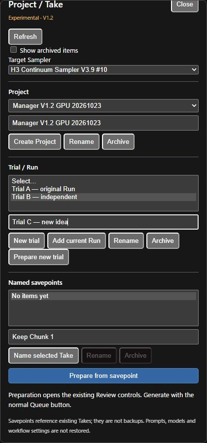

# ComfyUI-H3-Continuum 3.10.0 — V3.9

Generate long-form MiniMax H3 video and audio in chunks, review each result,
retry a section, and continue from compatible saved Takes.
**V3.9 is the current workflow; V3.8X2 remains available separately.**

[Download v3.10.0](https://github.com/ukr8b3g-cmyk/ComfyUI-H3-Continuum/releases/download/v3.10.0/ComfyUI-H3-Continuum-v3.10.0.zip) ·
[Release notes](https://github.com/ukr8b3g-cmyk/ComfyUI-H3-Continuum/releases/tag/v3.10.0) ·
[Checksums](https://github.com/ukr8b3g-cmyk/ComfyUI-H3-Continuum/releases/download/v3.10.0/SHA256SUMS.txt) ·
[日本語](README_JA.md)

## 3.10.0 — optional Project / Take Manager V1.2

An optional right-side panel for named Projects, independent trials and immutable
named Take savepoints. OFF by default; enable it in **Settings → H3Continuum →
Project Manager**, then open **H3 Continuum → Project / Take**. Preparing a
savepoint delegates to existing Review controls; generation starts with your
normal Queue action. No new node or workflow rewiring is required.

Final CPU/JavaScript regression, including panel reopening: **2,210 passed /
2 skipped / 0 failures**, with zero CUDA initialization attempts. Chrome
save/reload and four dedicated GPU Queues passed: Chunk 1 → Chunk 2 → alternate
Chunk 2 from the same savepoint → independent trial. The original Chunk 1 raw
hash and previous Takes were preserved; all four AV files decoded successfully.

Existing generation works without Manager. Savepoints reference existing data;
they are not backups or complete workflow restores. These are targeted functional
checks, not general video-quality or performance acceptance.
[Usage and safeguards](docs/PROJECT_TAKE_MANAGER_V12.md) ·
[Changes, test conditions and limits](docs/RELEASE_NOTES_V3100.md).
Manager V1.2 is included in package 3.10.0; the existing workflow remains V3.9.

### Manager walkthrough with actual screenshots

These Chrome screenshots show Manager V1.2 in English. Labels follow the
ComfyUI English/Japanese locale. Use your existing V3.9 workflow: **no additional
Sampler, graph node or rewiring is needed**.

| Term | Meaning | Example |
| --- | --- | --- |
| Project | An organizational container for trials and savepoints | A scene or film |
| Trial / Run | One generation history; independent trials use separate Runs | Idea A, Idea B |
| Take | An actual saved generation candidate | First and second versions of Chunk 2 |
| Named savepoint | A fixed name referencing a selected Take and its ancestry | Keep Chunk 1 |

#### 1. Enable Manager

1. Open ComfyUI **Settings** using the gear icon on the left.
2. Select **H3Continuum**, then find **Project Manager**.
3. Turn **Enable Project / Take Manager (experimental)** ON. It defaults to OFF;
   the blue switch in the screenshot is ON.
4. Close Settings. Other report/preview settings do not need to change.



#### 2. Open the panel and select the Sampler

1. Open the ComfyUI menu at the upper left, then **H3 Continuum → Project / Take**.
   **Open Project / Take** in Settings is another entry point. If closing Settings
   hides the panel, reopen it from the menu.
2. In the right-side panel, select **Target Sampler**. With multiple Samplers,
   match its node number to the intended V3.9 node in the workflow.



The panel runs from **Target Sampler → Project → Trial / Run → Named savepoints**.
This screenshot already has a test Project and two trials.



#### 3. Create a Project and attach the current Run

1. Give the Sampler a unique **Run Name**, use **Run Storage: Save + Auto Resume**
   to retain Takes, and generate normally. For a first exercise, choose
   **Review Each Chunk** and generate Chunk 1.
2. Type a title in the **Project** name field and click **Create Project**.
   Select the created Project, or select an existing one instead.
3. Type a display label such as `Idea A` in the **Trial / Run** name field.
4. Click **Add current Run** and select the added trial. This registers the
   target Sampler's existing Run without copying video/raw data or changing Takes.

Typing a name alone creates nothing and does not switch the Sampler's Run.
Use the relevant action button, then confirm the new item appears in the list.

#### 4. Name a Take you want to keep

1. Open the Sampler's **Render History**. Use **Previous Take / Next Take** to
   select the candidate you want to preserve.
2. In Manager, select the trial attached to that same Run. Saving against a
   different Run is rejected.
3. Enter a label such as `Keep Chunk 1` in the **Named savepoints** name field.
4. Click **Name selected Take**. Confirm its list entry and endpoint, such as
   **Through Chunk 1**.

Here, **Keep Chunk 1 · Through Chunk 1** is already saved. A savepoint at Chunk 2
includes that Take's ancestry through Chunk 2. Generating later chunks does not
move an existing savepoint to the latest Take.



#### 5. Continue from a savepoint

1. Set up the intended workflow, models, prompts and references. Manager does
   not restore these settings; prefix reuse still requires existing compatibility
   checks to pass.
2. Select **Project → trial → savepoint**.
3. Click **Prepare from savepoint**.
4. Confirm **Prepared. Check the Sampler and use the normal Queue button.**
   Check the selected Take and prefix range in the Sampler's Render History.
5. Press the normal **Run / Queue** button. Preparation alone starts no GPU job.

The existing Review view shows the selected Take and **Continue From Here**
range. Once Manager has prepared the action, you do not need to select another
Take action. The screenshot below is the Sampler's existing Review UI.



**Example: keep Chunk 1 and make two alternatives for Chunk 2.** Name Chunk 1,
prepare that savepoint and Queue to generate Chunk 2. Select the same savepoint,
prepare and Queue again for another Chunk 2. Under the tested identical settings,
the Chunk 1 raw hash stayed unchanged and Chunk 2 Variation advanced from 1 to 2.
The previous Chunk 2 Take remained available. You can name each Chunk 2 candidate
separately as well.

#### 6. Start an independent idea

1. In the same Project, type a new label such as `Idea B` in **Trial / Run**.
2. Click **New trial** and select the created trial.
3. Click **Prepare new trial**, then confirm the success message. Preparation
   clears the Sampler's Run Name and applies a fresh Run UUID together.
4. Check generation settings and press normal **Run**. This starts at Chunk 1
   in a separate Run, preserving the previous trial.



`Trial C — new idea` in the screenshot is an input example. Typing it alone does
not create Trial C or rename the selected Trial B. **New trial does not copy an
old prefix.** To retain Chunk 1 and change the continuation, use step 5 instead.
Browsing another Project/trial does not switch the Sampler either: select the
intended savepoint and explicitly prepare it when returning to an earlier idea.

#### 7. Organize names and close the panel

| Action | Steps and effect |
| --- | --- |
| Rename | Select the Project/trial/savepoint, edit its own name field and click its **Rename** button. Run filenames and generation settings stay unchanged. |
| Hide an item | Select it and click **Archive**. This does not delete videos, Takes or raw data. |
| Restore an item | Enable **Show archived items**, select the item and click **Restore**. |
| Reload management data | Click **Refresh**, especially after another tab has updated the Project. Review the new state before editing. |
| Close | Click **Close** at the panel's top right. Saved management data remains; closing does not cancel generation. |
| Work as before | Generate without opening the panel, or turn Manager OFF in Settings. |

#### 8. If an action is unavailable

- **Empty lists:** select the target Sampler, Project and trial; attach a Run if
  you have not done so yet.
- **Name selected Take fails:** select a Take in Render History and check that
  the selected Manager trial references the same Run.
- **Prepare new trial is disabled:** select a trial created with **New trial**;
  this action is not used for an attached named Run.
- **Preparation is refused:** wait for the target's queued/running job to finish.
  Connected identity/action inputs or conflicting Run identities can also block
  preparation. Do not force changes to an externally controlled workflow.
- **Read-only or incompatible Take:** Manager does not bypass Sampling v6. Restore
  the intended source conditions or start a new independent Run from Chunk 1.
  Do not delete saved history or edit reuse flags.
- **Missing/corrupt source:** savepoints require the original metadata and raw
  data. They are references, not backups; keep their source Runs.

Save your **workflow separately** to retain model, prompt and reference settings.
Project metadata is not a complete workflow save. See the
[Manager guide](docs/PROJECT_TAKE_MANAGER_V12.md) for additional safeguards.

## 3.9.12 — Reference Plan Inspector refresh

Fix stale verified Reference Plan text after the Sampler UI is reconfigured,
including workflow save/reload. Changing Reference assignments now invalidates
the old Inspector display; the next backend result supplies the verified plan.
Refresh callbacks do not accumulate, and Inspector text is not saved as workflow data.

CPU/JavaScript: **2,148 passed / 2 skipped / 0 failures or expected failures**.
Chrome save/reload checks passed. After actual GPU sampling, unchecking the
Reference assignment changed the visible Inspector heading from **runtime verified**
to **Configured only — Queue has not verified...**, without another Queue.
The 140 protected existing files and all three files of the new Run remained
hash-identical. This is targeted UI acceptance, not video-quality acceptance.

Update through Manager or replace the existing custom-node package, then
**restart ComfyUI and hard-refresh the browser (Ctrl+F5)**. Existing Takes and
workflows can be kept; no rewiring, deletion or new Run is required for this UI fix.
[Validation conditions and limits](docs/RELEASE_NOTES_V3912.md).

## 3.9.11 — Spectrum signature stability / Review continuation

Fix another confirmed cause of false Sampling v6 read-only: repeated imports of
unchanged audited Spectrum code can have different marshal encodings. A fixed,
Python-specific supplemental audit checks the complete loaded descriptors while
preserving the original saved identity. Unknown or modified code remains
non-reusable; existing safe v6 Takes keep their compatibility.

CPU/JS: **2,139 passed / 2 skipped / 2 known Inspector expected failures**.
Targeted browser/GPU checks with **Spectrum + Comfy Kitchen Attention** passed:
Review buttons enabled, **Chunk 1 preserved / Chunk 2 generated, one reused and
one new**, both audio/video outputs fully decoded. Scope: Python 3.13.12,
Core 0.42.1, Kitchen 0.2.39, audited local Spectrum, 512×512, 24 fps,
two 5-second chunks, 8-step Turbo, first pass only. These are targeted repair
checks, not all-provider, quality or performance acceptance.

Update the existing installation through Manager or replace its custom-node
package, **restart ComfyUI and hard-refresh the browser (Ctrl+F5)**. Use a new,
unique Run Name with Spectrum and Review Each Chunk to verify Chunk 1 → 2.
Keep existing Takes and workflows; old unsafe/v5 Takes are not promoted.

If a separate Custom Scripts menu thumbnail tries to load MP4 as an image,
turn **Settings → Show Image On Menu OFF**. This tested workaround prevents
new thumbnail HTTP errors; it is not a Continuum code fix and is not applied
automatically. [Full release notes and limits](docs/RELEASE_NOTES_V3911.md).

## 3.9.10 — Spectrum reuse and Reference assignments

Fix false Sampling v6 read-only caused by Spectrum source CRLF line endings,
and add separate audited Python 3.12 profiles for the two supported Spectrum
implementations. Existing Python 3.13 profiles and valid Take identities stay exact.
Unknown code or runtime state remains non-reusable.

With external Chunks inputs, the V3.9 Reference Images table shows an assignment
range of 1–16 instead of a stale widget count. This does not change the number
of generated chunks or expand saved selections automatically.

CPU/JS: **2,096 passed / 2 skipped / 2 known expected failures**. Separate
Python 3.12 component, storage and actual-JS checks passed. Reference table
browser acceptance passed. **No new GPU acceptance is claimed for 3.9.10.**

Restart ComfyUI and refresh the browser after updating. Keep existing workflows
and Takes. Start a new Run for a newly supported configuration; old unsafe/v5
Takes remain readable and are not automatically made reusable.
[Release notes and limits](docs/RELEASE_NOTES_V3910.md).

## 3.9.9 — KJ Preview Override / Review continuation

Fix new-Run v6 read-only with the separately audited upstream KJ profile, and
show saved reasons when reuse is unavailable. Keep the original local profile,
Sampling v6 guards, old Takes and official workflow bytes.

CPU: **2,075 passed / 2 skipped / 2 known expected failures**, plus overlapping
90-case JS coverage. Upstream KJ GPU and normal-ComfyUI browser Continue both
passed: **Chunk 1 preserved, Chunk 2 generated, one reused / one new**; all four
AV outputs fully decoded. Browser checks used the existing local KJ profile.
These are targeted repair checks, not general quality or all-provider acceptance.

Restart ComfyUI and hard-refresh after updating. On Preview Override, disconnect
optional VAE/Audio VAE and set Tiny VAE `none`; retain generation VAEs. Correct
unsupported settings before starting a new Run. Old unsafe/v5 Takes remain
readable and are not automatically made reusable. No workflow rewiring or Take
deletion is required. [Full release notes](docs/RELEASE_NOTES_V399.md).

## Getting started video

[Watch: H3 Continuum V3.9 — Chunks, Prompts & Reference Images](https://youtu.be/AKJxBXaiG6Q) — **12:26**, with English narration, subtitles and chapters.

The video covers First Image setup, chunk settings, Review/Take retries,
Timeline prompts and Reference Images. For screenshots and every control,
open the [illustrated user guide](docs/USER_GUIDE.md).

## Install or update

Use one Continuum installation in `ComfyUI/custom_nodes`.
Models and third-party custom nodes are not bundled.

### Fixed-version ZIP

1. Download the **custom-node ZIP** above and optionally verify its checksum.
2. Extract its package folder into `ComfyUI/custom_nodes`.
   When updating, replace the existing package; do not leave duplicate copies.
3. Restart ComfyUI and hard-refresh the browser (**Ctrl+F5**).
4. Open a V3.9 workflow below and select your installed models and input files.

Keep your saved workflows, Run/Take folders and settings when updating.
**Workflow ZIPs contain graphs, not the custom-node installer.**

### Git or ComfyUI-Manager

For a new Git installation:

```bash
cd ComfyUI/custom_nodes
git clone https://github.com/ukr8b3g-cmyk/ComfyUI-H3-Continuum.git
```

For an existing Git installation:

```bash
cd ComfyUI/custom_nodes/ComfyUI-H3-Continuum
git pull --ff-only origin main
```

If Manager owns your installation, update that copy through Manager.
Restart ComfyUI and refresh the browser after updating.
Registry review, Manager's selected version and GitHub Releases are separate;
the fixed-version links above identify the exact v3.9.12 package.

The package declares Python **3.10+** and ComfyUI **0.32.0+**.
The minimum declaration is not a GPU acceptance result for every Core version.

## Required model files and extensions

Download the weights separately from [Comfy-Org / MiniMax-H3](https://huggingface.co/Comfy-Org/MiniMax-H3).
The table follows the **saved V3.9 template selections**; folders are relative to `ComfyUI/`.

| Component | File / download | Folder |
| --- | --- | --- |
| H3 diffusion model | [minimax_h3_fl2va_pruned_int8_convrot.safetensors](https://huggingface.co/Comfy-Org/MiniMax-H3/resolve/main/diffusion_models/minimax_h3_fl2va_pruned_int8_convrot.safetensors) | `models/diffusion_models/` |
| Text encoder | [qwen3vl_32b_minimax_h3_nvfp4_awq.safetensors](https://huggingface.co/Comfy-Org/MiniMax-H3/resolve/main/text_encoders/qwen3vl_32b_minimax_h3_nvfp4_awq.safetensors) | `models/text_encoders/` |
| Video VAE | [minimax_h3_video_vae_int8_convrot.safetensors](https://huggingface.co/Comfy-Org/MiniMax-H3/resolve/main/vae/minimax_h3_video_vae_int8_convrot.safetensors) | `models/vae/` |
| Audio VAE | [minimax_h3_audio_vae_fp32.safetensors](https://huggingface.co/Comfy-Org/MiniMax-H3/resolve/main/vae/minimax_h3_audio_vae_fp32.safetensors) | `models/vae/` |

Select the downloaded files in the loaders; set the text encoder's type to `minimax`.
Reselect paths if the saved `minimax/` subfolder differs from your installation.
The Video VAE loader selects INT8, although its older embedded download metadata names FP16;
choose the VAE you actually installed. [Other model variants](https://huggingface.co/Comfy-Org/MiniMax-H3/tree/main/diffusion_models) must match the generation task and loader support.
Quantized variants require compatible Core/GPU support; these selections are not a universal hardware guarantee.
The retained V3.8X2 graph instead saves DasiwaMinimaxH3_dasiwaHybridV2_int8.safetensors and
[FP16 Video VAE](https://huggingface.co/Comfy-Org/MiniMax-H3/resolve/main/vae/minimax_h3_video_vae_fp16.safetensors).
That custom model is not bundled or supplied by the table above; reselect a compatible H3 model you have installed.

The complete supplied graph also needs these external node packages:

- [Spectrum](https://github.com/xmarre/ComfyUI-Spectrum-MiniMax-H3) — optional acceleration; saved disabled. Its presence does not imply every version is reuse-compatible; see the compatibility table below.
- [KJNodes](https://github.com/kijai/ComfyUI-KJNodes) — supplies the template's H3 SageAttention patch. Follow its attention dependency requirements, or replace/bypass that patch if unavailable.
- [rgthree-comfy](https://github.com/rgthree/rgthree-comfy) — supplies `Power Lora Loader (rgthree)`.

**Optional Turbo:** download one task-matched [LightX2V Turbo LoRA](https://huggingface.co/lightx2v/Minimax-h3-Turbo) into `models/loras/`; the standard workflows start with all entries disabled. The separate Turbo Sample enables one LoRA.
Follow that LoRA's sampler/step instructions; [listed files and setup](docs/USER_GUIDE.md#turbo-lora-and-spectrum-in-supplied-workflows) explain the choices. Models and extensions are not installed by Continuum.

## Choose a workflow

| Workflow | Download | Use |
| --- | --- | --- |
| **V3.9** | [JSON](examples/workflows/MiniMax_H3_Continuum_V39.json) / [ZIP](examples/workflows/MiniMax_H3_Continuum_V39.zip) | Current Sampler and fixed Reference Image slots |
| **V3.9 Turbo Sample** | [JSON](examples/workflows/MiniMax_H3_Continuum_V39_Turbo_Sample.json) / [ZIP](examples/workflows/MiniMax_H3_Continuum_V39_Turbo_Sample.zip) | Auto, 2 x 8s dance and Thai rap; [setup and limits](docs/TURBO_SAMPLE.md) |
| **V3.8X2** | [JSON](examples/workflows/MiniMax_H3_Continuum_V38X2.json) / [combined ZIP](examples/workflows/MiniMax_H3_Continuum_V38X2.zip) | Retained workflow; combined ZIP also contains V3.9 |

They are also available in **Templates → ComfyUI-H3-Continuum**.
V3.8X2 graphs and their Reference wiring are not automatically converted to V3.9.
Keep the original graph and open the dedicated V3.9 graph for new work.

The templates reference external Spectrum, rgthree and KJNodes nodes.
Install, replace or remove missing optional dependencies before Queue.
In the standard workflows, Spectrum and Turbo LoRA entries are saved disabled; ComfyUI-Easy-Use is not required.

In the V3.9 template, select your own **First Image** file before Queue.
Reference loaders 1–6 start bypassed and all per-chunk assignments start off.
Slots 7–9 require you to add and connect loaders.
See [template setup and screenshots](docs/USER_GUIDE.md#start-here-v39-and-the-retained-v38x2-workflow).

## First generation

Start with a small two-chunk test before a long sequence.

1. Select your H3 model, text encoder, sampler and appropriate VAE files.
2. Write `Sequence Prompt`; use `Prompt Format = Fixed` for one shared prompt.
3. For image-to-video, use `Size Source = First Image` and choose a resolution.
   The template starts at **Draft — 0.30 MP**. For exact Width/Height, use `Manual`.
4. Set `Chunks` to **2**, `Seconds per Chunk` to **5**, and check `Total Length` = **10 seconds**.
5. Keep `Base Seed` unchanged and `Control After Generate` set to `fixed`.
6. Set `Run` to `Review Each Chunk` and `Progress` to `On — Resume and Takes available`.
7. Leave `Regenerate From = Auto`, read `Ready to Queue`, then press ComfyUI's top-right **Run** button.

`Chunks` is the final target count, not the number to add on the next Queue.
Review normally generates one review unit at a time: the first output in this
example is **5 seconds**, even though the target is 10 seconds.
With Last Image terminal merging, the final two logical chunks may form one unit.

For uninterrupted generation, select `Generate Full Video` instead.
Keep Progress on if you want saved Takes, compatible resume and later regeneration.

## Review, continue and retry

Selecting a Review action does not start sampling. Select it, then press
ComfyUI's **Run** button (`Queue`) to execute it.

| Action | Next Queue |
| --- | --- |
| `Use it and continue` | Keep accepted chunks and generate the next review unit |
| `Try this chunk again` | Keep earlier chunks and create another Take of the reviewed unit |
| `Use it and finish the rest` | Keep accepted chunks and generate all remaining units |
| `Back to Settings` / `Return to Review` | Navigate between settings and review; neither queues work nor deletes Takes |
| `Use This Take` | Select a stored result without new sampling; decoding/saving may still run |
| `Continue From Here` | Branch from the selected Take and generate the next review unit |

For the **2 × 5-second** example, continue after Chunk 1 to reuse it and generate
Chunk 2; the completed result is **10 seconds**.
At completion, retrying the current unit creates another Chunk 2 Take.

Keep the same model/LoRAs, seed, prompts, media, dimensions, sampling schedule,
continuation settings and Run identity while continuing.
Keeping only the seed fixed is insufficient to guarantee reuse.
Read the status/reuse counts before treating a result as a successful continuation.

To extend a completed sequence, keep those conditions and `Regenerate From = Auto`,
increase the final `Chunks` target, and Queue again.
[Illustrated Review, Take and extension steps](docs/USER_GUIDE.md#review-continue-and-revise-a-chunked-video).

## Regenerate from a chosen chunk

1. Open settings and choose **Regenerate From = Chunk N**.
2. Keep Progress on and earlier-chunk generation inputs unchanged.
3. Choose `Generate Full Video` to rebuild N through the target in one Queue,
   or `Review Each Chunk` to pause after the next review unit.
4. Set **Variation Nonce** and press ComfyUI's **Run** button.
5. Restore `Regenerate From = Auto` before ordinary continuation or Take actions.

Nonce **0** requests another automatic variation after a completed regeneration;
a compatible interrupted regeneration resumes its existing variation.
A positive Nonce fixes that variation: repeating it with identical inputs does
not request a new result. Review retry manages its own variation separately.

Earlier compatible chunks and previous Takes are retained.
Later chunks follow the changed continuation, so Full Run from Chunk 2 may
regenerate more than Chunk 2 when the target contains additional chunks.
Terminal-merged pairs are atomic; arbitrary frames inside a chunk cannot be edited.
[Regeneration details and compatibility](docs/REGENERATE_INTENT_V396.md).

## Prompts and Reference Images

- **Fixed:** one shared prompt; **List:** per-chunk prompts; **Timeline:** time-based instructions.
- V3.9 Reference Images uses fixed **Image 1–9** slots and one Sampler connection.
  `All chunks` shares connected images; `Per chunk` lets you tick assignments.
- `@R1` always means Image 1, even if other slots are empty. Use tags only for
  active References; resolved picture numbers can differ by physical group.
- First/Last Image, Reference Images, Reference Audio and Driving Audio have
  different roles. Driving Audio preserves a source track; Reference Audio conditions generation.
- For a Reference-only test, turn First/Last Image off and choose Manual size.
  A terminal-merged final pair needs the same effective Reference set in both chunks.
- Pre-resize large source images: conditioning resize does not eliminate
  source-loading RAM use. A subject may persist through video continuity after its assignment ends.

[Reference guide](docs/V39_REFERENCE_INLINE.md) ·
[Prompt examples](docs/README_HISTORY.md#prompt-formats) ·
[V3.9 prompt skill](https://github.com/ukr8b3g-cmyk/ComfyUI-H3-Continuum/tree/main/write-h3-v39-reference-prompts) ·
[General prompt resources](docs/USER_GUIDE.md#prompt-and-skill-downloads)

## Storage, decoding and Second Pass

Progress saves Run/Take data for compatible reuse. The optional **Decode Cache
Helper** caches decoded results; it is separate from saved sampling history.
Finalize assembles the output; downstream Core nodes create and save the video.

Set scratch storage under **Settings → H3Continuum → Storage → Manage temporary storage**.
The folder is on the ComfyUI server and applies to Finalize and Decode Cache.
It does not move saved Runs/Takes or finished videos.
Change or clean it only with empty running/pending queues.
Moving folders on one physical drive does not reduce that drive's writes.
[Storage modes, cleanup and limits](docs/TEMPORARY_STORAGE_JA.md).

**Second Pass** is an optional bridge for external refinement/upscaling.
It is separate from chunk continuation and ordinary Review retries.
The V3.8X2 standard workflow does not require Hi-Res Fix.
V3.8 Second Pass does not support partial Review sequences; V3.9 can inherit
validated conditioning for its actual output groups.
[Integration contract](docs/V38_OPEN_INTEGRATION_CONTRACT.md).

## Compatibility and verification scope

| Area | Supported boundary |
| --- | --- |
| Saved history | Existing Takes stay readable. Old v5 or unsafe history is not repaired or promoted into reusable Sampling v6 history; start a new Run when required. |
| Unknown MODEL wrappers | Fresh generation remains available; reuse requires observable, matching contracts. No blanket approval by class name or version. |
| Attention / Spectrum | Finite audited profiles support Core PyTorch/Kitchen and specified Spectrum implementations, including upstream v0.2.29. [Exact scope](docs/ISSUE31_SAMPLING_SIGNATURES.md). |
| KJ Model Preview Override | Only the separately audited local and upstream KJ/Core profiles: **VAE / Audio VAE disconnected, Tiny VAE `none`**, Core NoPreviews/Auto/Latent2RGB. A KJNodes version number alone is insufficient. [3.9.9 support update](docs/RELEASE_NOTES_V399.md) / [supported hashes](docs/KJ_PREVIEW_OVERRIDE_V398.md). |

Historical published **v3.9.8** verification passed new-Run, separate-Queue Chunk 1→2 GPU continuation
with **PyTorch + KJ** and **Comfy Kitchen INT8 + audited local Spectrum + KJ**.
Preview images remained held, original Chunk 1 data/contracts stayed unchanged,
and all four video/audio outputs decoded successfully.
These were 512×512, 24fps, 2×5-second, 8-step Turbo Core-API tests on an RTX 5060 Ti 16 GB.
They do not establish support for other KJ/Spectrum builds or preview-VAE paths.
[Full conditions and verification limits](docs/RELEASE_NOTES_V398.md).

## Known limitations

- **Mobile:** reduced UI work is verified; mobile freeze resolution is unconfirmed.
- **Resources:** nine high-resolution References or long final decoding can exhaust
  VRAM/RAM. Disk-backed Finalize does not prevent allocations in other nodes.
- **Refinement:** high-ratio latent resize can cause artifacts; longer Hi-Res/Hybrid
  cases and doubled outlines remain limited or under investigation ([Issue #27](https://github.com/ukr8b3g-cmyk/ComfyUI-H3-Continuum/issues/27)).
- **Continuity:** exact identity, motion, lip sync and frame-by-frame reproduction
  are not guaranteed. Some long continuations have known quality limits.
- **Acceptance:** browser Run-button/save-reload, the reporter's exact full graph,
  other provider builds, subjective quality and speed/VRAM benchmarks were not
  established by the historical v3.9.8 GPU recheck. Later targeted checks are
  recorded separately in the release notes above.

## Detailed documentation

| Topic | Read more |
| --- | --- |
| Setup, screenshots and complete controls | [Illustrated user guide](docs/USER_GUIDE.md) |
| Current Reference Images | [V3.9 Reference guide](docs/V39_REFERENCE_INLINE.md) |
| Updating from V3.8X2 | [Migration and retained contracts](docs/V38_RELEASE_AND_MIGRATION.md) |
| History, earlier screenshots and implementation notes | [README history](docs/README_HISTORY.md) / [CHANGELOG](CHANGELOG.md) |
| Current release and GPU verification | [v3.10.0 notes](docs/RELEASE_NOTES_V3100.md) / [package validation](PACKAGE_VALIDATION.txt) |
| Bug reports | [GitHub Issues](https://github.com/ukr8b3g-cmyk/ComfyUI-H3-Continuum/issues) — include the workflow, status text and `auto-resume disabled:` reason |

Historical Releases and tags remain available. Documentation updates on `main`
do not replace published tags or package assets.
This condensed README changes documentation only; public nodes, official
workflow JSON/ZIP files, Sampling v6 and existing Runs/Takes are unchanged.

## License

[MIT](LICENSE). Third-party components retain their own [licenses and notices](THIRD_PARTY_NOTICES.md).
