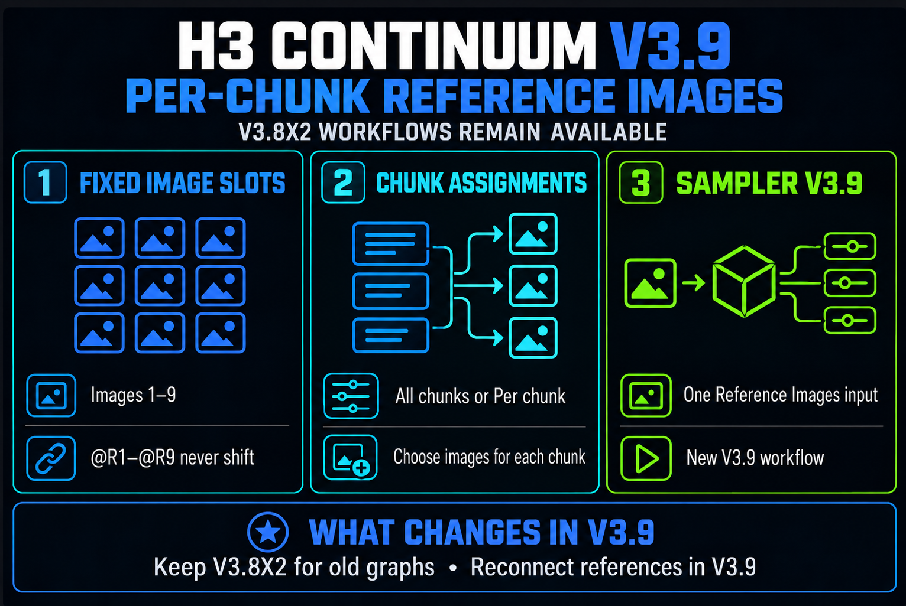
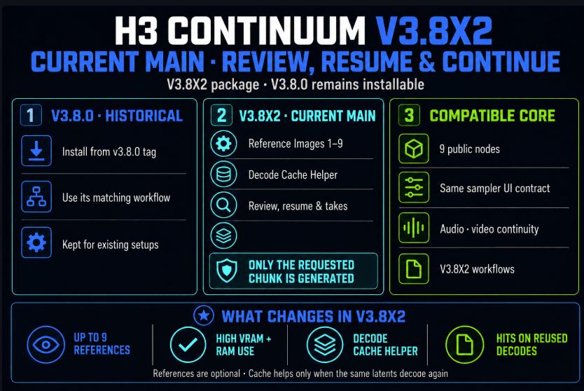

# H3 Continuum — README history and implementation reference

[Current README](../README.md) · [Illustrated user guide](USER_GUIDE.md) · [CHANGELOG](../CHANGELOG.md)

This reference preserves the release descriptions, earlier screenshots, detailed
validation results and pre-V3.8 implementation notes previously shown in README.
It was extracted from source commit `894869d9` (package 3.9.8).
Statements such as "current on main", historical installation commands, node lists
and old acceptance results retain their original context; they are not current
installation recommendations or broader validation claims.
For current downloads, compatibility and known limits, start with the README.

- [v3.9.8 and published-tag GPU conditions](#398--kj-model-preview-override-continuation)
- [Older implementation notes](#archived-implementation-notes-pre-v38-not-the-current-guide)
- [Prompt formats and examples](#prompt-formats)
- [Historical resource and validation limits](#limits)

<!-- Preserved README sections begin. -->


**Latest package: 3.9.8.** Use the fixed-version GitHub downloads below. Registry publication is verified separately.

| Version | Release | Custom-node ZIP | SHA-256 checksum |
| --- | --- | --- | --- |
| 3.9.8 | [Release](https://github.com/ukr8b3g-cmyk/ComfyUI-H3-Continuum/releases/tag/v3.9.8) | [ZIP](https://github.com/ukr8b3g-cmyk/ComfyUI-H3-Continuum/releases/download/v3.9.8/ComfyUI-H3-Continuum-v3.9.8.zip) | [SHA256SUMS.txt](https://github.com/ukr8b3g-cmyk/ComfyUI-H3-Continuum/releases/download/v3.9.8/SHA256SUMS.txt) |
| 3.9.7 | [Release](https://github.com/ukr8b3g-cmyk/ComfyUI-H3-Continuum/releases/tag/v3.9.7) | [ZIP](https://github.com/ukr8b3g-cmyk/ComfyUI-H3-Continuum/releases/download/v3.9.7/ComfyUI-H3-Continuum-v3.9.7.zip) | [SHA256SUMS.txt](https://github.com/ukr8b3g-cmyk/ComfyUI-H3-Continuum/releases/download/v3.9.7/SHA256SUMS.txt) |
| 3.9.6 | [Release](https://github.com/ukr8b3g-cmyk/ComfyUI-H3-Continuum/releases/tag/v3.9.6) | [ZIP](https://github.com/ukr8b3g-cmyk/ComfyUI-H3-Continuum/releases/download/v3.9.6/ComfyUI-H3-Continuum-v3.9.6.zip) | [SHA256SUMS.txt](https://github.com/ukr8b3g-cmyk/ComfyUI-H3-Continuum/releases/download/v3.9.6/SHA256SUMS.txt) |
| 3.9.5 | [Release](https://github.com/ukr8b3g-cmyk/ComfyUI-H3-Continuum/releases/tag/v3.9.5) | [ZIP](https://github.com/ukr8b3g-cmyk/ComfyUI-H3-Continuum/releases/download/v3.9.5/ComfyUI-H3-Continuum-v3.9.5.zip) | [SHA256SUMS.txt](https://github.com/ukr8b3g-cmyk/ComfyUI-H3-Continuum/releases/download/v3.9.5/SHA256SUMS.txt) |
| 3.9.4 | [Release](https://github.com/ukr8b3g-cmyk/ComfyUI-H3-Continuum/releases/tag/v3.9.4) | [ZIP](https://github.com/ukr8b3g-cmyk/ComfyUI-H3-Continuum/releases/download/v3.9.4/ComfyUI-H3-Continuum-v3.9.4.zip) | [SHA256SUMS.txt](https://github.com/ukr8b3g-cmyk/ComfyUI-H3-Continuum/releases/download/v3.9.4/SHA256SUMS.txt) |
| 3.9.3 | [Release](https://github.com/ukr8b3g-cmyk/ComfyUI-H3-Continuum/releases/tag/v3.9.3) | [ZIP](https://github.com/ukr8b3g-cmyk/ComfyUI-H3-Continuum/releases/download/v3.9.3/ComfyUI-H3-Continuum-v3.9.3.zip) | [SHA256SUMS.txt](https://github.com/ukr8b3g-cmyk/ComfyUI-H3-Continuum/releases/download/v3.9.3/SHA256SUMS.txt) |
| 3.9.2 | [Release](https://github.com/ukr8b3g-cmyk/ComfyUI-H3-Continuum/releases/tag/v3.9.2) | [ZIP](https://github.com/ukr8b3g-cmyk/ComfyUI-H3-Continuum/releases/download/v3.9.2/ComfyUI-H3-Continuum-v3.9.2.zip) | [SHA256SUMS.txt](https://github.com/ukr8b3g-cmyk/ComfyUI-H3-Continuum/releases/download/v3.9.2/SHA256SUMS.txt) |

## 3.9.8 — KJ Model Preview Override continuation

An audited KJ Model Preview Override can keep preview images without changing a new Run's sampling identity. Separate Queues can reuse Chunk 1 and generate Chunk 2 while preserving earlier Takes. Support is limited to the explicitly pinned KJ source and Core helpers, **VAE / Audio VAE disconnected, Tiny VAE `none`**, and Core NoPreviews/Auto/Latent2RGB. Other KJ builds remain conservative; version 1.5.2 alone is insufficient. Restart ComfyUI, refresh the browser and start a new Run; do not delete old Takes or workflows. See [compatibility, source hashes and verified scope](KJ_PREVIEW_OVERRIDE_V398.md).

### Published v3.9.8 GPU recheck — 2026-10-16: PASS

After restarting the normal ComfyUI installation with the published tag **`v3.9.8` / `58fbd855`**, all 464 installed release files matched the tag. The startup log confirmed 3.9.8, and new saved Sampling v6 contracts contained the KJ adapter and pinned audit-profile digest. Two brand-new Runs passed four Core-API GPU Queues:

| KJ Preview Override configuration | Separate-Queue Chunk 1 → 2 |
| --- | --- |
| Model Attention Backend: PyTorch, Spectrum OFF | **PASS — 1 reused / 1 generated** |
| Model Attention Backend: Comfy Kitchen INT8 + audited local Spectrum | **PASS — 1 reused / 1 generated** |

On both second Queues, the KJ MODEL stayed cached with preview images retained (**8 → 16**), while the Sampler executed. The contract/revision and original Chunk 1 latent hashes stayed unchanged; `resume_safe=true`. All four video/audio outputs fully decoded (5 seconds / 120 frames, then 10 seconds / 240 frames, 512×512 at 24fps). Existing workflows and Takes were preserved: 170 protected files, including 71 saved workflow files and 46 pre-existing Run/Take files, retained their hashes.

**Scope:** only the exact audited KJ/Core profile; the local KJ source differs from upstream, so KJNodes 1.5.2 alone is insufficient. Preview Override VAE / Audio VAE were disconnected, Tiny VAE was `none`, Core preview was Auto. GPU: RTX 5060 Ti 16 GB, 8-step Turbo, Euler/simple, 2×5-second chunks. Spectrum used the audited local offline-replay implementation, system-RAM history/archive and model-aware OFF. **Unverified:** browser Run-button/save-reload behavior, the reporter's exact complete graph, other KJ/Spectrum builds, SolAttn/preview VAE paths, per-kernel return tracing, subjective quality and speed/VRAM benchmarks. Retained PNGs were 32×32, not high-resolution preview-quality evidence. The known Inspector issue remains; old unsafe/v5 Takes are not repaired or promoted. [Issue #31 result](https://github.com/ukr8b3g-cmyk/ComfyUI-H3-Continuum/issues/31#issuecomment-6209571261).

## 3.9.7 — External-input regeneration cache fix

Fix automatic Full Run variations when Chunks or Variation Nonce come from external nodes. Unresolved linked inputs no longer let Core skip an explicitly requested regeneration. Earlier accepted chunks, existing Takes, public inputs and official workflows are preserved. Update the custom nodes, restart ComfyUI and refresh the browser; no workflow changes or history deletion are required. [Release notes](RELEASE_NOTES_V397.md).

**Published v3.9.7 GPU recheck (2026-10-15): PASS.** After restarting with the published tag (`18df80d`), external Core INT nodes supplied Chunks=2 and Nonce=0. Two completely identical Chunk 2 regeneration prompts advanced automatic Nonce **1 → 2**; both reused Chunk 1 and generated only Chunk 2. Earlier Takes and raw latents were retained. All three outputs (baseline plus two variations) fully decoded with 240 frames and 10-second video/audio. Existing 60 workflows, one settings file, 30 Run/Take files and all 459 release files remained hash-identical. Scope: RTX 5060 Ti 16 GB, 512×512, 24 fps, 2×5 seconds, 8-step Turbo, PyTorch attention, Spectrum OFF, Core API submissions. No CUDA/OOM/execution errors were observed; this does not extend browser, subjective-quality or other-accelerator acceptance.

The original [3.9.2 GitHub source archive](https://github.com/ukr8b3g-cmyk/ComfyUI-H3-Continuum/archive/refs/tags/v3.9.2.zip) remains available from its unchanged tag. This custom-node package ZIP is distinct from the official workflow ZIPs.


## 3.9.6 — regeneration selections and automatic variations

Explicit **Regenerate From** and **Variation Nonce** survive V3.8/V3.9 workflow save/reload. With progress saving enabled, **Full Run + an explicit Chunk + Nonce 0** reaches Run Storage on every Queue, allowing another automatic variation after a completed Take. Earlier accepted chunks and previous Takes are kept. Restart ComfyUI and refresh the browser. For an older unmarked Chunk 1 / nonce 0, select Chunk 1 again and save once. See [operation, compatibility and verified scope](REGENERATE_INTENT_V396.md).

## 3.9.5 — Issue #31: reusable Attention and Spectrum contracts

Review Each Chunk can resume new Runs using Core Model Attention Backend with PyTorch or Comfy Kitchen INT8 and an explicitly audited Spectrum binding, including upstream Spectrum v0.2.29. Existing unsafe history remains readable and read-only for reuse; start a new Run after updating. Public node IDs, workflows and Sampling v6 are unchanged. See [supported implementations, update steps and validation limits](ISSUE31_SAMPLING_SIGNATURES.md).

## 3.9.4 — Registry packaging repair (2026-10-14)

Include the declared Review restoration guide and exclude repository-only prompt-authoring files from the Registry ZIP. The publishing workflow now builds the actual package and checks its exact file set, CRC and every Registry Manifest hash before uploading. Runtime behavior, twelve public node IDs, workflows and saved Runs/Takes are unchanged. GitHub Releases 3.9.3 and 3.9.2 remain available.

## 3.9.3 — choose temporary storage (2026-10-13)

Choose where Continuum writes its temporary decoded frames and Finalize buffer. Open **Settings → H3Continuum → Storage → Manage temporary storage**. Enter an absolute folder on the **ComfyUI server**, or choose a server storage candidate, then validate and save. Leave it blank to keep the existing locations. No workflow changes are required; continue using the V3.9 nodes and your 3.9.1 / 3.9.2 workflows.

- The selected folder applies to **both Finalize and Decode Cache Helper**. It contains a dedicated `h3-continuum-scratch` directory. Saved Runs/Takes and finished videos keep their existing locations.
- The panel shows current and previous locations, temporary file sizes, free space, and files in use or eligible for deletion. **Delete unused temporary files** protects live outputs, Tensor views, active processes and files whose ownership cannot be verified. Deleting a cache can require decoding and writing it again.
- Save or clean only when the running and pending queues are empty. New files use the new location; existing outputs remain valid at their old locations. A missing selected drive does not silently redirect writes to your original SSD. Shared storage controls are read-only in multi-user mode.
- Mode selection stays in the existing nodes: **Finalize: Auto / RAM / Disk-backed**; **Decode Cache Helper: Auto / RAM / Off**. Auto keeps its conservative 4 GiB final-IMAGE threshold and RAM reserve. Manual RAM now checks available memory before allocation; manual Disk-backed checks free space. These checks cannot guarantee against OOM, changing disk usage or a drive disconnect during execution. No new VRAM storage mode is added.

**Moving storage changes where writes occur, not their total volume.** With only one physical drive, moving to another folder or partition on that drive does not divert its writes. A separate SSD is usually the faster alternative; an HDD can be used but may slow decoding, assembly and saving. If sufficient CPU RAM is available, RAM modes can avoid these scratch writes, but memory pressure can cause paging or OOM. Turning Decode Cache Off does not turn off Finalize's Disk-backed buffer. File-size displays are logical sizes, not physical disk allocation or cumulative SSD writes. Local filesystems are supported; network shares are outside this feature's supported scope.

Update the custom node package, restart ComfyUI to load the backend, and hard-refresh the browser. Later changes to this storage setting take effect without a restart. Blank settings retain the ComfyUI temp directory for Finalize and `H3_DECODE_CACHE_TEMP_DIR` (or OS temp) for Decode Cache. A selected folder takes precedence over that cache environment variable.

The storage changes preserve frame dtype, video/audio assembly and generation identity. Validation and remaining platform limits are recorded in [PACKAGE_VALIDATION.txt](../PACKAGE_VALIDATION.txt). The implemented settings screenshot appears at the top of this README. GitHub Release and Registry publication status are listed above; neither follows automatically from a source update.

If the panel reports HTTP 404, inspect the ComfyUI startup log. An old process can keep the chosen address/port occupied, so the updated process fails to start while its new JavaScript is already visible. Stop the obsolete instance or choose another port, then start the updated backend. **Refresh** retrieves storage status; it does not restart ComfyUI. Failed reads now show the HTTP result and keep mutations disabled until status is available.

## 3.9.2 — Issue #30 frontend hotfix (2026-10-13)

This hotfix reduces unnecessary Review and Reference Images UI work:

- Skip upstream Review settings snapshots when no comparison baseline exists.
- Notify connected Samplers once per Reference selection, preserving immediate native values and the original widget callback.
- Skip Reference node resizing when its target dimensions already match its actual dimensions.

Review monitoring with a baseline and fresh Take/Queue checks remain in place. Sampling, saved Runs/Takes, public node IDs and official workflow bytes are unchanged. Keep using the V3.9 nodes.

The frontend repair passed **1,703 CPU/JavaScript regression tests, 2 skipped**, with **2 explicit expected failures** for the independent Reference Plan Inspector bug after repeated Sampler configuration. Offline Core registration/planning and isolated Chromium checks passed. Real ComfyUI browser checks for this package are recorded in [PACKAGE_VALIDATION.txt](../PACKAGE_VALIDATION.txt); mobile freeze resolution is unconfirmed. Reference table rebuilding and Review snapshots with a baseline remain. No new GPU generation is part of this hotfix's validation.

After updating, **hard-refresh the browser (Ctrl+F5)** to load the JavaScript. Restart ComfyUI normally to update the displayed package version. A 3.9.1 Run/Take does not require migration for this UI hotfix. Versioned downloads are listed in [GitHub Releases](https://github.com/ukr8b3g-cmyk/ComfyUI-H3-Continuum/releases); Registry publication is separate.

## 3.9.1 — what changed (2026-10-04)

This patch fixes Second Pass conditioning, Take reuse and Review audio:

- **Second Pass:** preserve audio-only/mixed keyframes and inherit the verified conditioning and Reference assignments of the actual Review output, including a single middle chunk.
- **Take reuse:** include sampler closures and MODEL CFG/wrappers in compatibility checks to prevent reuse under different generation settings.
- **Review Driving Audio:** cut the source PCM once at the physical group's natural time, with the same start position for Exact ON/OFF.
- **Audio resampling:** prefer ComfyUI Core's standard API, with the legacy fallback for older Core versions. The Reference Encode Cache limitation for direct VAE weight changes is documented below.

**Updating from 3.9.0:** restart ComfyUI and refresh the browser after updating. Existing v5 Takes and history remain readable and are not deleted, but cannot be reused as prefixes for new v6 generation. Start a new Full Video or choose **Start again from Chunk 1**. Public node IDs, widget order and official workflows remain unchanged; keep using the **V3.9** nodes.

The repaired code passed **1,696 CPU tests / 1 skipped**, targeted Review Second Pass GPU checks and an integrated generation/reuse check. Browser acceptance remains pending. Optional latent-upscale doubled outlines are tracked separately in [Issue #27](https://github.com/ukr8b3g-cmyk/ComfyUI-H3-Continuum/issues/27); they are not a required gate for these fixes. This is a main-source update, not a new GitHub Release or Registry publication.

## 3.9.1 repair details

Second Pass preserves audio-only keyframes and adapts only the video component of mixed keyframes. Review Driving Audio uses the retained natural frame range of the physical decode group, measured before projection. Exact ON/OFF share that PCM origin. Completely empty Review intervals receive silence for the selected video duration; partially short audio stays short with Exact OFF.

New generation uses Sampling Contract v6 and Graph Contract v4, including sampler code/closures and MODEL CFG/wrapper settings. Saved v5 Takes, raw tensors and provenance remain readable, but cannot be reused in v6 generation. Start a new Full Video or use Review's **Start again from Chunk 1** to create a new revision. Old Takes remain intact. Unobservable external settings still allow fresh generation with reuse disabled; incompatible explicit Take/Retry requests are not replaced with a different Take.

Reference/Driving resampling prefers Core's standard API and uses legacy TorchAudio only when that API is absent. Preserved output PCM keeps its original waveform and sample rate.

**Reference Encode Cache limitation:** direct weight mutation inside the same VAE object is not detected automatically. Call `v3.ref_encode_cache.clear_ref_encode_cache()` afterwards or reload into a new VAE object. Unchanged VAE/input pairs continue to hit the cache. Decode Cache Helper reset affects a separate cache and does not clear Reference Encode Cache.

This repair stays within V3.9: public node IDs, socket/widget order, official workflows, Run Storage v3 and State/Session formats are retained. LoRA Plan is not included. CPU checks and browser/GPU acceptance are separate.

V3.9 also projects captured conditioning onto the actual Review output groups before Second Pass. A partial prefix or a single middle chunk can inherit its own conditioning and Reference assignments when the context validates. Full-sequence completion and saved Takes are unchanged; missing or mismatched context keeps the diagnostic prompt-only fallback.

The repaired runtime passed **1696 CPU tests, 1 skipped**, and three targeted GPU cases at **512×512 / 24 fps**: a two-group partial prefix, Chunk 2 alone, and complete three-group reuse. All groups inherited verified conditioning; saved FLAC matched the corresponding source PCM exactly and existing Takes/raw files were preserved. This validates the targeted repair. Browser acceptance remains pending; optional latent-upscale double outlines are a separate investigation in Issue #27. Historical V3.8 releases and tags remain available unchanged.



*V3.9 is current on `main`: fixed Image 1–9 slots, per-chunk Reference selection, and one Reference Images connection to the V3.9 Sampler.*

## Getting started video

[H3 Continuum V3.9 — Getting Started: Chunks, Prompts & Reference Images](https://youtu.be/AKJxBXaiG6Q) (12:26)

Learn basic First Image setup, chunk settings, Review/Take retries, Timeline prompting, and Reference Images. Includes English narration and subtitles, seven timestamped chapters, version-labeled UI stills, and actual generated examples.



*This V3.8X2 card is retained for comparison. Its “CURRENT MAIN” label describes the time it was made; V3.9 is current now. The V3.8 Sampler and V3.8X2 workflow remain available, but their Reference wiring is not automatically converted to V3.9.*

## External INT Width/Height fix on main (2026-10-01)

Fixed the visible Width/Height input binding in both V3.8 and V3.9. External INT connections now stay aligned with their displayed controls through workflow save/reload and tab switching. Connected controls are read-only; their displayed numbers are saved Manual reserve values, not a prediction of the upstream node's runtime output. Disconnecting restores local editing.

To set exact dimensions from Core **Int** nodes, choose **Size Source = Manual** and connect the Width and Height INT inputs. **First Image** still uses the image and Resolution setting; connected dimensions do not override it or automatically change Size Source. If no active First Image is available, the existing Manual fallback applies. Dimension validation and backend input order/defaults are unchanged.

Validation: **1569 CPU tests passed, 1 skipped**, including 22/22 new frontend regression cases and 60/60 existing Review cases; Chrome save/reload and five tab round trips for both versions. One V3.9 GPU smoke run with external INT values produced exactly **480×640, 96 frames at 24 fps, with 4-second audio** in **107.3 s** (20 sampling steps); the entire saved video decoded successfully. This is a short single-condition check, not long-form or all-model acceptance. Sampling, Run Storage, the earlier Review/cache repairs, official workflow JSONs/ZIPs and historical Releases are unchanged.

Update Continuum from `main`, then **hard-refresh the browser (Ctrl+F5)** to load the new JavaScript. This fix alone does not require a ComfyUI backend restart; restart normally if the update also brings Python changes or new node definitions. This remains a main-source fix, not a new Release or Registry package.

## V3.9 performance fix on main (2026-10-01)

V3.9 could repeat unnecessary prompt-conditioning preparation when **Prompt Format = Fixed** and **no Reference Images are selected**. This repair reuses the existing bounded conditioning cache when its inputs are unchanged. First Image is supported; List/Timeline prompts, selected Reference Images, Reference Audio, Timeline Video and terminal-pair groups keep their existing paths. This is not the Decode Cache Helper and does not skip Sampling.

In the tested `2 × 5 s`, 480×640 First Image workflow, group preparation fell from about **10.76 s to 0.013 s**. In the post-fix same-session comparison (three measured runs per version, after warm-up), median total time was **273.58 s for V3.8 vs 273.78 s for V3.9**; the ranges overlapped. The earlier roughly 6% gap was no longer observed under these conditions. This does **not** establish a speed fix for every workflow, model or GPU, or a GPU-kernel speedup.

Update Continuum from `main` and **fully restart ComfyUI** to load the Python changes. Validation: **1558 CPU tests passed, 1 skipped; all 8 GPU generation runs succeeded** on ComfyUI 0.38.0 / RTX 5060 Ti 16 GB. Seeds, chunk/frame contracts, Run Storage, V3.8X2/V3.9 official workflows and ZIPs, and historical Releases are unchanged. This is a main-branch fix, not a new Release or Registry package.

## Review restoration fix on main (2026-10-01)

Switching to another workflow and back could hide Review actions even though saved Takes still existed. This frontend repair waits for workflow restoration before reading history and ignores stale results from previous graphs. Real generation-setting changes still disable Review/Take application; restoring the original settings re-enables the actions.

Update the custom node from `main`, then refresh the browser to load the new JavaScript. Validation: 60/60 frontend regression cases, 108 focused CPU tests, five Chrome tab round trips, and a Chrome Base Seed edit/restore test; saved Take metadata stayed unchanged. Sampling, Run Storage contracts, V3.8X2/V3.9 workflow files and historical Releases are unchanged. GPU continuation was not tested for this repair. [Details and verification limits](REVIEW_RESTORATION_REPAIR.md).

## Archived implementation notes (pre-V3.8; not the current guide)

The version-labelled sections below are retained temporarily as source history only. They do not describe the V3.8 standard workflow, public surface, or recommended wiring. For an older workflow, use the migration policy and its matching historical Release/tag.

### V3.7 High-Resolution Refinement Foundation

V3.7 adds **H3 Continuum Sampler V3.7** and completes two foundations for resolution-changing Second Pass workflows without changing V3.6 Production defaults or the existing SIGMAS socket.

### Conditioning survives a resolution change

The Conditioning Adapter rebuilds First/Last images, continuation context, and an owned Still Image Guide at the target latent geometry. Physical-group ownership, Long Terminal Merge, Core PackedLayout/RoPE reconstruction, and first-pass Audio passthrough are preserved. Correctness gates passed at 704×704 and 1152×1152; larger canvases still require substantially more memory and processing time.

### RefineSchedule gives refinement ranges explicit meaning

The internal, versioned `RefineSchedule` contract supports `External`, `Full`, `Tail`, and `Partial`. `External` preserves the incoming SIGMAS tensor exactly, while `Tail` and `Partial` select exact ranges from the same source schedule. The accepted internal Tail 6 gate reproduced the six-evaluation suffix and preserved decoded Audio PCM bit-exact. This contract is an implementation foundation rather than a new public widget, and Production defaults remain unchanged.

### Tail 6 cuts Second Pass time by about one third

The largest practical benefit in V3.7 is a shorter high-resolution Second Pass when the internal schedule uses Tail 6. Instead of evaluating all ten points, Tail 6 runs the exact low-sigma suffix that performs the final refinement work.

| Second Pass range | Sampling time |
|---|---:|
| Tail 10 | **100.27 s** |
| Tail 6 | **64.18 s** |
| Saved | **36.09 s / 36.0%** |

In this gate, Tail 6 finished in about 64% of the Tail 10 time: roughly 1 minute 4 seconds instead of 1 minute 40 seconds. A separate Learned Latent Upscaler gate measured `121.17 s -> 66.32 s` for Tail 10 versus Tail 6, about 45% lower, while API total changed from `170.70 s` to `119.61 s`, about 30% lower. These measurements are configuration-specific and are not universal speed guarantees.

`RefineSchedule` does not make each model evaluation faster. It gives Continuum an exact, versioned way to manage and execute the Tail 6 range; the speedup comes from running six evaluations instead of ten. Tail 6 is not enabled automatically, and V3.7 does not change Production defaults.

### Still Image Guide remains Experimental

V3.7 can map one Still Image Guide from an absolute frame to its owning physical group and rebuild it from the original image during a high-resolution Second Pass. Its positioning, Terminal Merge ownership, Run Storage identity, and non-owner isolation passed correctness testing. Core Add Guide uses hard-anchor semantics, however, so a Guide can cause an abrupt trajectory change at the anchor and can redirect later motion. **Still Image Guide is Experimental and remains on Production HOLD.** It should not be treated as a smooth transition control.

### V3.6.1 Maintenance Hotfix

V3.6.1 fixes focused fail-open/compatibility issues without changing the accepted Balanced 22 Masked AV path. Mixed Timeline/List prompts now report `H3C-P105`; Timeline parsing ignores only standalone `---` lines, keeps existing uncovered-chunk fallback, and never stops generation because of prompt syntax.

With `Continuation Backend = Standard` and Audio Continuity enabled, `Balanced — 22 frames` continues to use Masked AV. `Fast — 5 frames`, `Strong — 39 frames`, and `Auto — conservative` now resolve to the accepted Reference Context transport before Run Storage identity is created. The selected UI values are not rewritten, and the status report states the resolved transport and reason. Standard with Audio Continuity disabled remains Masked Video; Compatibility remains Reference Context.

Run Storage now treats every absent Last Frame spelling as the same empty identity. A normal no-Last-Frame run can therefore extend from two to three chunks as `2 reused, 1 generated`, including narrowly compatible V3.6.1 caches whose former final chunk stored `none`. A real connected Last Frame and the Long Terminal Merge atomic pair remain strict. Turning Run Storage Off also resets the hidden Regenerate From and Variation Nonce values to `Auto` and `0` before queueing.

### V3.6 Masked AV Continuation


V3.6 adds **H3 Continuum Sampler V3.6**. Its Standard continuation backend places the previous finalized Video and Audio latent prefixes directly inside the next H3 target and protects them with Core noise masks. Unlike the V3.5 Reference Context route, it does not append the same prior frames as a separate Reference block, reducing the packed sequence processed by H3.

| Continuation Backend | Purpose |
|---|---|
| `Standard` | Recommended V3.6 path. Balanced 22 + Audio Continuity uses Masked AV; Fast 5, Strong 39, and Auto safely fall back to Reference Context. When Audio Continuity is off, Masked Video is used. |
| `Compatibility` | Advanced fallback using the accepted V3.5 Reference Context behavior. |

Internal transport identifiers are not exposed in the UI. Run Storage identity follows the resolved transport: Balanced 22 Masked AV stays separate from Reference Context, while a non-Balanced Standard fallback safely shares the identical accepted Reference contract. `Regenerate From` treats the Long Terminal Merge logical pair `[2,3]` as one atomic physical sample.

### Accepted behavior

- T2VA, I2VA, Reference Image + Reference Audio, Balanced 22-frame Joint AV, and 3×5-second FL2VA Long Terminal Merge GPU gates passed.
- Protected Video and Audio prefixes finalize bit-exact; generated regions remain owned by the sampler.
- The accepted Reference Image + Reference Audio output passed subjective audio listening with no reported click, dropout, or stereo-positioning defect.
- In the tested FL2VA Terminal Group 2 pairs, Standard removed 2,874 packed rows (`8.01%`) and reduced median Sampling time by `4.06%` versus Compatibility. Performance varies by model, hardware, and workflow.
- `chunk_seconds` now accepts 4.0–30.0 seconds with a 5.0-second default and 0.1-second step. The 5–15 second range remains recommended and validated; longer high-resolution chunks can substantially increase VRAM use and runtime.

In the historical V3.6 package, V3.5.3, V3.5, and V3.4 Node IDs remained registered for saved workflows. V3.5.3 retained its original Reference Context behavior rather than being silently redirected to the V3.6 backend. This is not a V3.8 registration guarantee.

## V3.5.3 Maintenance Hotfix

V3.5.3 is a distribution-integrity maintenance release. It repairs the public Conditioning Bridge workflow's Width/Height links, removes stale orphan link IDs from the published V3.4/V3.5 templates, corrects Hybrid `<Picture N>` warning numbering, and repairs one legacy PNG for strict image decoders.

There are no changes to generation behavior, nodes, sockets, Sampling, Conditioning payloads, Terminal Merge, Assembly, Seam, Run Storage, Prompt/CLIP caching, Video Guide optimization, or V3.4 compatibility. Existing V3.5.x workflows continue to load unchanged.

## V3.5.2 Stabilization & Optimization Update

V3.5.2 adds no new generation mode. It stabilizes the V3.5.x release, removes repeated Prompt/CLIP work when safe, and lowers temporary memory for long Video Guide inputs while preserving existing workflow and generation contracts.


The figure records the accepted optimization measurements. The final packaging gate additionally passed on ComfyUI 0.33.3 with a 172-entry Manifest, including this image.

### What changed

1. **Repeated-run Prompt/CLIP cache** — unchanged T2VA, I2VA, and FL2VA conditioning can reuse CPU-cached Prompt/CLIP results. Reference, scheduled, tokenizer-option, and hook-modified CLIP paths conservatively bypass the cache. Sampling still runs normally.
2. **Video Guide memory optimization** — the complete source remains part of finite validation and SHA-256 identity, but only the required prefix remains stored for VAE/conditioning work.
3. **Stabilization audit** — measured Sampling, Decode, Assembly, saving, optional-feature tax, and retained memory. No speculative Sampling, Driving Audio, Audio hash, Assembly, Seam, Session, or V3.4 optimization was adopted.

### Measured results

| Area | Before | V3.5.2 | Result |
|---|---:|---:|---:|
| T2VA repeated Prompt/CLIP | 5.898398 s | 0.000028 s | Cache HIT, `encode_calls=0` |
| FL2VA repeated Prompt/CLIP | 21.642687 s | 0.007128 s | Cache HIT, `encode_calls=0` |
| Video Guide peak additional RSS | 396.8 MiB | 114.7 MiB | About 71% lower |
| Video Guide retained storage | 225 MiB | 93 MiB | About 59% lower |

Prompt/CLIP figures measure only the conditioning subphase, not total generation time. The Video Guide memory benchmark uses deterministic 300×256×256 RGB input with a 124-frame required prefix. A separate GPU A/B used an actual 15-second / 360-frame Video Guide and produced identical decoded video and audio PCM.

The measured Sage-only production baselines on the tested RTX 5060 Ti 16 GB / 64 GB system were 168.069 seconds for 1×5-second 576×576 T2VA and 379.765 seconds for 3×5-second 640×640 FL2VA Long Terminal Merge. These are configuration-specific baselines, not universal speed guarantees. Sampling remained the dominant cost; Continuum Assemble + Seam stayed below 1%.

> **V3.8.0 is the historical release baseline.** V3.8X2 remains a separate package-3.8.3 workflow, while V3.9 source is available on `main`. Historical implementation modules remain in source because V3.8X2 reuses them internally. The current registration has ten V3.8X2 IDs plus two V3.9 IDs. Use the matching historical Release/tag for workflows requiring other IDs. Still Image Guide remains Experimental.

## V3.5.1 Reference Audio & Compatibility Update

V3.5.1 added two focused features without changing the V3.4 Sampling, Conditioning, Terminal Merge, Assembly, Seam, or Run Storage contracts:

1. **Optional Reference Audio** — native H3 audio conditioning that does not replace the generated final audio.
2. **Conditioning Bridge V3.5** — one complete Core-compatible `MODEL` and `CONDITIONING` object per Continuum physical group for external sampler workflows.

The Reference Audio sockets are permanently defined by Python `INPUT_TYPES`. Dynamic socket changes and the UI-only `Hidden / Show` control were removed to prevent workflow save/reload value shifts. Node IDs, backend keys, Sampling, Conditioning, standard Seed handling, and other widgets are unchanged.

In the historical V3.5.1 package, V3.4 node IDs and backend socket keys remained registered for saved-workflow compatibility. V3.4/V3.5 workflows continued to load there; V3.5.1 clarified the displayed input names without rewriting saved links. V3.8 instead uses the seven-node support boundary above.

### Reference inputs at a glance

The displayed names intentionally describe different jobs. They are not interchangeable pairs:

| Displayed input | Connect from | Purpose | Final audio behavior |
|---|---|---|---|
| `reference_image_1`–`reference_image_3` | Still-image `IMAGE` | Persistent identity, subject, or appearance references | No audio |
| `Video Guide Frames` | Video loader `IMAGE` frame batch | Persistent motion, framing, timing, and appearance guidance across chunks | Does not carry the video's audio |
| `Driving Audio` + `Driving Audio VAE` | Audio loader, or video loader `AUDIO`, plus the matching audio VAE | Audio guidance whose effective source stream is preserved for final output | Replaces generated final audio with the selected source stream |
| `Reference Audio (Optional)` + `Reference Audio VAE (Optional)` | Standalone audio plus the matching audio VAE | Native H3 conditioning only | Does not copy or replace the generated final audio |

For the common video-with-sound case, connect the loader's `IMAGE` output to `Video Guide Frames` and its `AUDIO` output to `Driving Audio`. Do not connect that audio to `Reference Audio (Optional)` unless conditioning-only behavior is specifically intended.


`Reference Audio (Optional)` and `Reference Audio VAE (Optional)` are always present exactly as defined by the node's Python input schema. V3.5.1 no longer adds or removes these sockets dynamically and has no frontend-only `Hidden`/`Show` widget. This keeps positional widget values aligned when workflows are saved and reloaded; backend input keys and existing workflow links are unchanged.


### Conditioning Bridge V3.5

`H3 Continuum Conditioning Bridge V3.5` is the Advanced connection point for external sampling. Connect `model`, `clip`, the externally processed `video_latents`, `assembly_plan`, and `refine_context`; connect `video_vae` only when the selected conditioning path requires it. The node returns parallel `group_models` and `conditioning` lists whose length equals the physical-group count. Each list item remains a complete ComfyUI object—conditioning entries are never flattened into the physical-group list.

```text
H3 Continuum Sampler V3.5.video_latents
  -> external H3 latent processor (for example LBH)
  -> H3 Continuum Conditioning Bridge V3.5
  -> Core BasicGuider + external sampler
  -> Core Video / Audio VAE Decode
  -> H3 Continuum Assemble + Seam V3.5
```

The external workflow owns AV LATENT pairing, noise, SIGMAS, Audio Lock, sampling, and audio passthrough. The Bridge only exposes the prepared `MODEL` and `CONDITIONING` objects plus the updated Assembly Plan.


The retired V3.5.1 LBH + Conditioning Bridge example is available only from its matching historical Release/tag; it is not a V3.8 workflow.

The example keeps the standard Core titles `BasicGuider`, `BasicScheduler`, and `SamplerCustomAdvanced`. Public examples do not rename Core nodes, so they remain immediately distinguishable from Continuum and third-party nodes. The workflow also uses external nodes for LBH latent upscaling, AV LATENT concatenation/separation, loading/saving, and optional acceleration; install or replace those nodes according to your ComfyUI environment.

LBH changes latent geometry only. It has no Continuum denoise-strength control: use the external `BasicScheduler` SIGMAS to decide how strongly the resized latent is regenerated. A larger LBH scale such as 1.5x may still be fast, but memory, decode, and sampling costs increase with the target canvas.

## What's new in V3.5

V3.5 has two major additions:

1. **Continuum-aware Second Pass / Hi-Res Fix** — refine externally processed H3 latents or use the integrated pixel/VAE 2x path without changing V3.4 sampling.
2. **Low-memory Assemble + Seam** — write the final video IMAGE directly to RAM or a Windows-safe mapped file while preserving Exact Duration, Seam, Terminal Merge order, and audio behavior.

### 1. Second Pass and Hi-Res Fix

**H3 Continuum Hi-Res Fix V3.5** is the one-node Main path. It performs Video VAE Decode, bounded pixel resize, Video VAE Encode, and one low-denoise Second Pass. The integrated Main path remains **Experimental** because long 2x runs can exceed GPU memory.


Normal Hi-Res Fix wiring:

```text
H3 Continuum Sampler V3.5
  -> H3 Continuum Hi-Res Fix V3.5
  -> Core Video / Audio VAE Decode
  -> H3 Continuum Assemble + Seam V3.5
```

**H3 Continuum Second Pass V3.5** is the stable Advanced bridge requested in Issue #8. It accepts an externally processed H3 video latent and samples each Continuum physical group once while preserving prompt policy, seed reporting, group order, and the original first-pass audio LATENT object.


External latent processor wiring, such as LBH:

```text
H3 Continuum Sampler V3.5.video_latents
  -> external H3 latent processor
  -> H3 Continuum Second Pass V3.5
  -> Core Video / Audio VAE Decode
  -> H3 Continuum Assemble + Seam V3.5
```

Connect the original `audio_latents`, `assembly_plan`, and `refine_context` from Sampler V3.5 to the Hi-Res Fix or Second Pass node. Use the same final MODEL and CLIP, plus a separate sampler and workflow-side SIGMAS for the refinement pass. The nodes do not contain an internal denoise value.

The `BasicScheduler` is deliberately omitted from the screenshots. It is still required to create the Second Pass `SIGMAS`. The GPU-tested baseline is:

```text
sampler:   res_multistep
scheduler: simple
steps:     10
denoise:   0.35
```

Do not chain Hi-Res Fix and another Second Pass in the standard path: Hi-Res Fix already performs one Second Pass internally. `H3 Continuum Latent Resize V3.5` is an advanced utility, not the recommended Main 2x path; direct high-ratio interpolation of the 24-channel H3 latent produced persistent artifacts in testing.

If Hi-Res Fix is not connected, V3.4 sampling remains on its original path. V3.5 does not add a forced CPU-offload or low-VRAM sampler mode. `Hi-Res Fix enabled=false` is a lazy exact passthrough and does not evaluate its resize, VAE, or Second Pass dependencies.

See [V3.5 Hi-Res Fix and Second Pass workflow guide](V35_HIRES_FIX.md) for exact sockets, bypass behavior, external-upscaler wiring, and limits.

### 2. Low-memory Assemble + Seam

**H3 Continuum Assemble + Seam V3.5** adds manual RAM / Disk-backed selection and a conservative Auto policy. Disk-backed mode writes the final video IMAGE directly to a mapped file instead of rebuilding the entire completed video in anonymous RAM. Audio remains in RAM.

| Backend | Behavior |
|---|---|
| Auto | Uses RAM only when the final IMAGE is at most 4 GiB and physical-memory reserve is sufficient; otherwise selects Disk-backed. Missing memory counters fail safely to Disk-backed. |
| RAM | Existing in-memory output behavior. |
| Disk-backed | Maps the final video IMAGE to a temporary file; video only. Audio remains in RAM. |

Disk-backed mode preserves the backing file while ComfyUI still references the returned Tensor. Downstream nodes can still allocate a full RAM copy, so Continuum's low-memory guarantee applies to its own assembly stage, not arbitrary downstream implementations.

#### Measured memory reduction

The validated stress case assembled a deterministic `1536 x 1536`, 360-frame float32 IMAGE with a final size of `9.49 GiB`. RAM and Disk-backed outputs were video/audio hash-identical.

| Windows process metric | RAM backend | Disk-backed | Reduction |
|---|---:|---:|---:|
| Private memory | 12.41 GiB | 2.91 GiB | **9.50 GiB** |
| USS | 10.29 GiB | 0.80 GiB | **9.49 GiB** |

This is a **system-RAM/private-commitment** reduction during Continuum Assembly, not a claim that sampler GPU VRAM is reduced. Windows RSS includes resident mapped-file pages and was therefore similar between the two backends; private memory and USS are the relevant measurements. Disk-backed I/O can make final assembly slower, but it does not slow the preceding model sampling path.

#### Optional Windows tip: disable pinned memory

For MiniMax H3 on Windows, starting ComfyUI with `--disable-pinned-memory` can substantially reduce host-RAM pressure. In one local RTX 5060 Ti 16 GB / RAM 64 GB check, a `0.4 MP (640 x 640), 2 x 5s` run completed in `5m 23s`, with about `6.1 GB` sampler RSS and `8.6 GB` after assembly, while showing little practical speed difference from normal startup.

```text
--disable-pinned-memory
```

This is an environment-specific tip, not a default requirement or a universal crash fix. Compare the same workflow and seed with only this option changed, and keep it only when memory use improves without a meaningful speed or stability regression. It disables ComfyUI's pinned host-memory path; it does not guarantee that Windows Shared GPU Memory will never be used.

### GPU acceptance at a glance

| Path | Tested condition | Result |
|---|---|---|
| Main Hi-Res Fix | FL2VA 1 x 5s, 576 -> 1152 | PASS |
| Main Hi-Res Fix | Hybrid FL2VA + Reference 1 x 5s, 576 -> 1152 | PASS |
| Advanced Second Pass | Hybrid/Reference 1 x 5s, 576 x 576 | PASS |
| Main Hi-Res Fix | FL2VA 3 x 5s, 576 -> 1152, RTX 5060 Ti 16 GiB | **CUDA OOM at terminal 77T group** |

For the failed 3 x 5s case, First Pass and the 37T Second Pass group completed. The final logical chunks `[2,3]` remained one 77T Long Terminal Merge physical group and exceeded the tested 16 GiB GPU at its first 1152x1152 Second Pass inference. This is a documented resource limit; the Continuum grouping contract did not change.

## V3.4 compatibility baseline

The historical V3.5 package retained V3.4 nodes for saved workflows; it did not replace their Node IDs, public sockets, Sampling, Conditioning, Terminal Merge, Assembly, Seam, or Run Storage behavior. Those historical workflows remain available through the corresponding Release/tag. Current V3.9 exports only its twelve registered IDs, even when older implementation modules remain in source.


V3.4 focuses on the two reference workflows that are most useful in normal production:

- **Driving Audio**: use an existing audio source as the preserved final audio while it guides the H3 generation across chunks.
- **Video Guide Frames**: use a video loader's IMAGE frame batch as persistent guidance for appearance, motion, framing, and timing without treating it as a frame-by-frame copy.
- **Hybrid FLF + Reference**: use First Frame, Last Frame, and persistent Reference Images together without adding a separate mode or model allowlist.
- **FL2VA Terminal Merge**: keep the final two 5-second FL2VA chunks as one physical 10-second sampling and decode unit for Core-equivalent Last Frame handling.
- **Restartable chunks**: reuse completed chunks with Run Storage and regenerate only the selected part when the generation contract remains compatible.
- **Core compatibility**: remove Continuum-only rejection of unknown upstream/custom nodes and remove the obsolete `strict_compatibility` control.
- **Spectrum interoperability**: use the official H3 Continuum Interop API v1 when Spectrum is installed; Spectrum remains optional.
- **Simpler public interface**: Timeline Video and the earlier timeline-audio paths are hidden from the V3.4 public sampler interface rather than being presented as stable production features.

### Direction change: from timeline generation to preserved references

Earlier development explored Timeline Video and timeline-audio conditioning. Those paths can be useful for experiments, but they are not the default production behavior: chunk boundaries can change visual content, and generated audio can diverge from a supplied song, dialogue, or effects track.

V3.4 therefore prioritizes:

1. **Driving Audio** for cases where the supplied audio should remain the final audio stream.
2. **Video Guide Frames** for cases where a supplied video should guide the generated result without requiring exact frame reproduction.
3. **Chunked generation and Run Storage** for practical retries and long-form work.

This is a usability and reliability decision, not a claim that the experimental timeline paths are impossible. They are hidden from the stable interface while the public workflow stays focused on predictable user-controlled inputs.

## Example workflow

- [V3.9 workflow JSON](../examples/workflows/MiniMax_H3_Continuum_V39.json) and [ZIP](../examples/workflows/MiniMax_H3_Continuum_V39.zip) — current V3.9 graph; the ZIP contains only this JSON
- [V3.8X2 workflow JSON](../examples/workflows/MiniMax_H3_Continuum_V38X2.json) — retained V3.8X2 graph; Spectrum is disabled by default
- [V3.8X2 workflow ZIP](../examples/workflows/MiniMax_H3_Continuum_V38X2.zip) — contains both the V3.8X2 and V3.9 JSON files; it is not a custom-node installer
- [V3.8X2 Helper-explicit JSON](../examples/workflows/MiniMax_H3_Continuum_V38X2+Decode_Cache_Helper.json) and [ZIP](../examples/workflows/MiniMax_H3_Continuum_V38X2+Decode_Cache_Helper.zip) — the same graph under an explicit distribution name

The declared Registry payload includes both V3.9 and V3.8X2 graphs; it is **not dependency-free**. Spectrum, rgthree, and KJNodes must be installed separately; ComfyUI-Easy-Use is not required. Historical workflow files remain in GitHub source but are excluded from the Registry payload. For an older saved workflow, use its matching historical Release/tag as described in the [migration policy](V38_RELEASE_AND_MIGRATION.md). Registry packaging validation/publication is separate from this GitHub source update.

## V3.4 feature details

### Driving Audio

Driving Audio is the primary V3.4 audio path.

- Source audio guides each chunk at its absolute sequence position.
- The original effective stream is preserved for final output.
- Generated audio and Audio Seam processing are bypassed while Driving Audio is active.
- Audio is not independently rewritten at every chunk boundary.
- Perfect lip sync is not guaranteed; results still depend on H3, source material, prompts, and sampling.

### Video Guide Frames

`Video Guide Frames` provides a persistent native H3 video guide across all chunks. Despite its ComfyUI `IMAGE` socket color, it expects the frame batch produced by a video loader rather than one ordinary still-image reference.

- It guides motion, framing, timing, and appearance.
- It is not a direct pixel-copy or deterministic identity-transfer system.
- Video and audio are independent. Route a loader's IMAGE output to `Video Guide Frames` and AUDIO output to `Driving Audio`.
- Source decoding and frame-rate conversion remain loader responsibilities. Continuum does not impose an unnecessary forced 24 fps conversion.

| Video Guide Size | Purpose |
|---|---|
| Efficient - 0.4 MP | Default; lower token cost and faster iteration. |
| Balanced - 0.6 MP | More detail at a higher compute cost. |
| Match Output | Largest reference input; potentially much slower and heavier. |

#### Conditional size controls and internal resize

The compact V3.5 UI shows each size control only when its corresponding input is connected:

- Connect any of `reference_image_1` through `reference_image_3` to reveal `Reference Size`.
- Connect `Video Guide Frames` to reveal `Video Guide Size`. Earlier workflows and reports may call this control `Video Reference Size`; V3.5.1 uses the clearer display name `Video Guide Size` while preserving the existing backend key and saved-workflow compatibility.

These controls are therefore not missing from a newly created node; they are hidden until relevant. Reference Images and Video Guide Frames are resized internally before VAE encoding. Video Guide Frames preserve their aspect ratio, align to the H3 canvas, and use Lanczos when reduction is needed. Smaller sources are not enlarged automatically. An external resize node is normally unnecessary, but remains useful for deliberate cropping, forced upscaling of a small source, or a custom resize/upscale algorithm. Video decoding and frame-rate conversion remain the loader's responsibility.

### Hybrid First/Last Frame + Reference Images

You need an hybrid version of MiniMax-H3 to make both I2V and reference images work:

https://huggingface.co/smhfacct/Minimax-H3-fl2va-ref2va-hybrid-models

https://www.reddit.com/r/StableDiffusion/comments/1vm62pj/i_tested_out_the_b2049_hybrid_variant_for_r2v/

V3.4 supports First Frame, Last Frame, and persistent Reference Images in the same Continuum run. The public sockets and controls are unchanged: connect the inputs that the selected H3 model supports.

- Pure FL2VA and pure Ref2VA identity contracts remain unchanged.
- The combined path receives a distinct hybrid identity so Run Storage does not reuse incompatible chunks.
- Prompt/reference mismatches produce guidance warnings rather than a Continuum-only execution stop.
- No model-name allowlist or automatic model replacement is used.

Local checks passed with the B2049 hybrid variant. FL-only models could run, but showed less reliable transitions when FLF and Reference Images were combined; a hybrid-capable model is therefore recommended for this path.

### FL2VA Terminal Merge

For 5-second FL2VA workflows, Continuum keeps the final two logical chunks together as one physical sampling and VAE decode unit.

- `2 x 5s`: one 243-frame physical sample, decoded once, then adjusted to the requested 240-frame output.
- `3 x 5s` and longer: earlier chunks use normal Continuation; the final two chunks use one 260-frame physical sample containing the 22-frame continuation context.
- After the terminal physical decode, the 22-frame context prefix is removed. For `3 x 5s`, this gives `124 + 238 = 362` frames before exact-duration adjustment to 360 frames.
- If the final two prompt sections differ, they are rebased internally to a local `[0-5s]` / `[5-10s]` timeline. Identical prompts retain the accepted shared-prompt path.
- The terminal pair uses one physical seed and one physical decode while Run Storage continues to preserve normal logical chunk entries.

Local GPU comparison confirmed that `2 x 5s` matches Core 10-second FL2VA sampling and terminal decode behavior. A `3 x 5s` Timeline run also passed with three logical chunks, two physical sampling passes, two physical decode groups, and a 15.000-second output. The short still period near the supplied Last Frame was also present in the equivalent Core result and is treated as normal FL2VA convergence rather than a Continuum-specific failure.

### Core-first, permissive execution

V3.4 removes or relaxes Continuum-only rejection rules that blocked otherwise runnable Core H3 experiments.

- Prompt problems prefer warnings and fallback behavior instead of stopping.
- Unknown upstream/custom wrapper classes are not blanket-rejected.
- There is no model allowlist and no automatic model replacement.
- The obsolete strict_compatibility control is removed from the V3.4 interface.
- Current Core PackedLayout behavior is supported without requiring the removed legacy frame_count argument.

Hard stops remain only for states that cannot execute safely, including corrupt latent topology, incompatible assembly data, invalid persisted revisions, or unusable mandatory payloads.

### Cleaner interface

The public nodes focus on normal production controls. Developer diagnostics and detailed reports are available through ComfyUI settings. The current release path uses `H3 Continuum Sampler V3.8`; older sampler and assembler notes below are retained for historical compatibility context.


### Timeline paths

Experimental Timeline Video and earlier timeline-audio paths remain in historical implementation code but are not exported by V3.8. Open V3.3 workflows with their historical package; new V3.8 workflows should use `Driving Audio` and `Video Guide Frames`.

## Installation

V3.8 is verified against ComfyUI 0.34.2. Historical acceptance records below may mention older ComfyUI versions; they are not the current installation target.

### Updating an existing installation

For a Git checkout, run the update from the custom-node directory:

```powershell
cd ComfyUI/custom_nodes/ComfyUI-H3-Continuum
git pull --ff-only origin main
```

Restart ComfyUI after the update. If the node was installed with ComfyUI Manager, use its **Update** action instead of running `git pull` manually. Do not mix Manager updates and a separate Git checkout for the same installation.

After the backend restart, search for `H3 Continuum Sampler V3.8` with the V3.8X2 workflow, or `H3 Continuum Sampler V3.9` and `H3 Continuum Reference Images V3.9` with the V3.9 workflow. The source registers twelve IDs in total. If they are missing, check the startup console for the `H3 Continuum 3.9.0 loaded` message and any `ComfyUI-H3-Continuum` import error.

Search for H3 Continuum or Continuum in ComfyUI Manager, or install manually:

~~~bash
cd ComfyUI/custom_nodes
git clone https://github.com/ukr8b3g-cmyk/ComfyUI-H3-Continuum.git
~~~

Restart ComfyUI after installation or update.

## V3.5 nodes

### H3 Continuum Sampler V3.5

The V3.5 sampler preserves V3.4 generation behavior and adds `refine_context` as the sixth output. Connect it to V3.5 Hi-Res Fix, Second Pass, or Conditioning Bridge paths that need the original conditioning context. V3.5.1 also provides permanently visible optional Reference Audio sockets.

### H3 Continuum Conditioning Bridge V3.5

Advanced external-sampler bridge. It returns aligned `group_models` and complete `conditioning` objects per physical group together with the updated Assembly Plan. It does not create AV LATENT pairs, noise, SIGMAS, Audio Lock, or external sampling policy.

### H3 Continuum Hi-Res Fix V3.5 (Experimental)

Main convenience node. When enabled, it performs the Video VAE pixel-resize round trip and Second Pass internally. When disabled, video/audio LATENT objects and the Assembly Plan pass through unchanged and the sampling/VAE dependencies remain lazy.

### H3 Continuum Second Pass V3.5

Advanced Issue #8 bridge for an externally processed video latent. It samples once per physical group, reads the physical prompt contract from the Assembly Plan, and returns the original first-pass audio LATENT objects.

### H3 Continuum Latent Resize V3.5

Utility that changes only video-latent H/W. It does not sample. Direct 2x interpolation at large square targets is not the accepted Main Hi-Res Fix method.

### H3 Continuum Assemble + Seam V3.5

V3.4-compatible assembly with Auto, RAM, and Disk-backed video-buffer backends. Exact Duration and seam corrections write directly to the selected target buffer.

## V3.4 nodes

### H3 Continuum Sampler V3.4

Main inputs:

- model, clip, video_vae, sampler, sigmas
- Sequence Prompt
- first_frame, last_frame
- reference_image_1 through reference_image_3
- Video Guide Frames
- driving_audio, audio_vae

Outputs:

- video_latents, audio_latents
- assembly_plan, status
- driving_audio

Visible controls:

- Prompt Format, chunks, chunk_seconds
- width, height, continuity
- base_seed, control after generate
- audio_continuity
- Run Storage
- Reference Size
- Video Guide Size

`chunk_seconds` uses one shared duration for every chunk. The default is 5.0
seconds; 5–15 seconds remains the recommended and validated range. Durations up
to 30.0 seconds are supported, but values above 15 seconds can substantially
increase VRAM use and processing time, especially at high resolution. Per-chunk
variable durations are not supported.

### H3 Continuum Assemble + Seam V3.4

Inputs: images, audio, assembly_plan, and driving_audio.

Controls: Audio Seam and Video Seam.

When Driving Audio is connected, preserved source audio is selected for final output and generated audio seam processing is bypassed.

## Connection order

~~~text
H3 model / CLIP / Video VAE / sampler / sigmas
                         |
                         v
              H3 Continuum Sampler V3.4
                 |       |        |
          video_latents  |   assembly_plan
                         |
                  audio_latents

video_latents -> Core VAE Decode ------- images --+
audio_latents -> Core VAE Decode Audio -- audio  --+--> H3 Continuum Assemble + Seam V3.4
assembly_plan -------------------------------------+
driving_audio -------------------------------------+
~~~

For a source video with sound:

~~~text
Video loader IMAGE -> Video Guide Frames
Video loader AUDIO -> driving_audio
~~~

The supplied templates use Video Helper Suite for this split. Any compatible IMAGE/AUDIO loader may be substituted.

## Prompt formats

### Timeline

For **Timeline** mode, each time-range header must be written on its own line. Write the scene description on the following line or lines.

Recommended format:

~~~text
[0-5s]
First section: action, camera movement, and scene progression.

[5-10s]
Continue from the exact final state of the previous section.

[10-15s]
Continue naturally without resetting the scene.
~~~

For 10-second chunks:

~~~text
[0-10s]
Describe the first scene.

[10-20s]
Describe the next scene.

[20-30s]
Continue the sequence.

[30-40s]
Describe the final section.
~~~

**Important:** do not place the prompt text on the same line as the time header.

Correct:

~~~text
[0-5s]
Describe the scene.
~~~

Not recommended:

~~~text
[0-5s] Describe the scene.
~~~

The second form is not recognized as a Timeline header. When **Prompt Format = Auto**, it may therefore be interpreted as a Fixed prompt instead, causing the complete text to be reused across chunks.

The time ranges should normally match the configured `chunk_seconds`.

- `chunk_seconds = 5` → `[0-5s]`, `[5-10s]`, `[10-15s]` ...
- `chunk_seconds = 10` → `[0-10s]`, `[10-20s]`, `[20-30s]` ...
- `chunk_seconds = 15` → `[0-15s]`, `[15-30s]`, `[30-45s]` ...
- `chunk_seconds = 30` → `[0-30s]`, `[30-60s]`, `[60-90s]` ...

#### Global preamble and per-chunk prompting

Text placed before the first Timeline header is treated as a **global preamble** and is automatically included in every chunk prompt. This is a good place for information that should apply throughout the sequence, such as subject definitions, overall style, persistent environment details, or other global instructions.

However, the Timeline sections do not need to contain only the changing action or scene description. For complex scenes, multiple characters, or longer chunks such as 10–15 seconds, it can be useful to repeat important details about the subjects, appearance, location, camera, and current scene state inside each section. More self-contained chunk prompts may sometimes give H3 stronger continuity and reduce cut-like transitions or drift.

Continuum carries visual/audio context from the previous chunk, but that does not guarantee that H3 will preserve every semantic detail automatically. Instead of relying only on phrases such as "continue from the previous chunk," describe the intended next action and important continuity details explicitly.

For example:

~~~text
Subject: A woman in a red jacket.
Style: cinematic nighttime photography.

[0-15s]
A woman in a red jacket stands at the nightclub bar, speaking with two people beside her. Medium shot, slow handheld camera movement, crowded dance floor visible behind them.

[15-30s]
The same woman in the same red jacket continues the conversation at the same bar with the same two people. The camera remains close and slowly moves around the group as one person replies.

[30-45s]
The woman turns toward the dance floor while remaining beside the bar. Keep the same clothing, nightclub environment, nearby characters, and continuous camera style.
~~~

The global preamble is optional. If fully self-contained prompts inside every Timeline section give better continuity for a particular model or scene, that is also a valid approach.

### Other prompt formats

**List** prompts use `---` separators.

**Fixed** reuses one prompt for every chunk.

**Auto** detects Timeline, List, or Fixed formatting from the supplied text.

If Timeline syntax cannot be parsed, V3.4 reports a warning and falls back to an applicable prompt mode rather than rejecting an otherwise runnable workflow.

## Run Storage

Run Storage preserves completed chunks and can reuse them after restarting ComfyUI. Regenerate From selects the first chunk to regenerate; earlier compatible chunks remain unchanged.


### Keep the first part and regenerate the second part

For a normal T2VA or I2VA run configured as `2 chunks x 5 seconds`, Chunk 1 is the first five seconds and Chunk 2 is the second five seconds.

Before the first generation:

1. Set `Run Storage` to `Save + Auto Resume`.
2. Choose a fixed `Run Name` and keep the Base Seed fixed.
3. Generate the complete ten-second video once. Continuum stores the raw Video/Audio latent for each completed chunk.

To generate a different second part while keeping the first part:

1. Keep the same Run Name, Base Seed, model, LoRA, resolution, sampler, SIGMAS/steps, references, and Continuation settings.
2. Set `Regenerate From` to `Chunk 2`.
3. Leave `Variation Nonce = 0` for automatic new variations after completed regenerations, or choose a different positive value for an explicit variation. A compatible interrupted regeneration at `0` resumes its existing variation; reusing the same positive value does not request a different result.
4. Queue the workflow again.

Continuum loads the stored Chunk 1 instead of Sampling it again, uses its finalized end as the continuation context, and Samples a new Chunk 2. The report should show `1 reused, 1 generated`. The complete output is then decoded and assembled again; the saved first chunk is reused, while boundary Seam processing is evaluated during the new assembly.

If the two parts need different instructions, define them with List or Timeline Prompt syntax before the first generation. Changing the Prompt Plan or other generation-contract inputs after a stored run can create a new revision, in which case the previous Chunk 1 may not be reusable. A run originally generated with `Run Storage = Off` cannot be reused retroactively. `Regenerate From` works at chunk boundaries; it does not edit an arbitrary region inside one chunk.

FL2VA Long Terminal Merge is an important exception: its final two logical chunks are one atomic physical Sampling unit, so those two chunks are regenerated together.

- Use a fixed seed for reproducible resume.
- Changing persistent models, LoRAs, references, prompts, resolution, or sampling settings can create a new revision.
- Unknown upstream node classes no longer cause rejection by themselves; reuse still depends on compatible observable contracts and hashes.

## Spectrum interoperability

Spectrum is optional. Current Spectrum releases officially support H3 Continuum Interop API v1.

- Chunk 1 uses the normal initial path.
- Chunk 2 and later request Actual Prefix 2.
- Successful continuation logs accepted H3 Continuum API v1, actual prefix=2.
- Unsupported Spectrum versions fall back without a private patch.

See [Spectrum v0.2.15 H3 Continuum interoperability](https://github.com/xmarre/ComfyUI-Spectrum-MiniMax-H3#v0215-h3-continuum-interoperability).

Turbo LoRA and Spectrum are not mutually exclusive. Quality and speed remain workflow-dependent.

## Issue and pull-request response

### Issue #3

V3.4 removes blanket rejection of unknown upstream/custom class names. Run Storage evaluates the observable generation contract instead of treating an unfamiliar wrapper as automatically incompatible.

See [Issue #3](https://github.com/ukr8b3g-cmyk/ComfyUI-H3-Continuum/issues/3).

### Issue #4

V3.4 follows the current Core H3 layout contract and no longer requires the legacy frame_count parameter. The old strict-compatibility toggle is not part of the public interface.

See [Issue #4](https://github.com/ukr8b3g-cmyk/ComfyUI-H3-Continuum/issues/4).

### Issue #7

V3.4 allows First Frame, Last Frame, and Reference Images to be used together without requiring the separate BigStationW node or introducing a model allowlist. Hybrid presentation ordering and Run Storage identity are handled by Continuum while pure FL2VA and pure Ref2VA behavior remain unchanged.

The combined path was exercised locally with the B2049 hybrid variant. FL-only models were less consistent for this specific combination, so the README recommends a hybrid-capable model rather than rejecting other models in code.

See [Issue #7](https://github.com/ukr8b3g-cmyk/ComfyUI-H3-Continuum/issues/7).

### Pull request #1 and #2

These older partial pull requests were superseded by the consolidated [Pull request #5](https://github.com/ukr8b3g-cmyk/ComfyUI-H3-Continuum/pull/5). V3.4 selectively includes the compatibility direction needed for the current Core H3 contract, while the broader upstream synchronization and release-automation scope remains a separate upstream review.

The older pull requests are not represented as merged V3.4 changes.

### Pull request #5

PR #5 is the consolidated upstream-to-fork proposal covering current H3 compatibility, reference-input handling, assembly memory behavior, exact-duration handling, continuation-reference interoperability, and CI/release automation. V3.4 already contains the user-facing stability decisions described above; the PR remains an upstream review item and is not claimed as merged here.

## V3.4 input connection patterns

V3.4 separates the video-guide frame input from the driving-audio input. Choose the connection pattern that matches your source material.

### 1. Audio only

Connect `Load Audio` to `Driving Audio`. Use this when an existing song, dialogue track, or sound effect should remain the final audio. `Video Guide Frames` is not required.


### 2. Video with its own audio

Connect `Load Video (Upload)` `IMAGE` to `Video Guide Frames`. If the uploaded video contains the audio you want to preserve, connect its `AUDIO` output to `Driving Audio` as well.


### 3. Video and audio from separate sources

Connect `Load Video (Upload)` `IMAGE` to `Video Guide Frames`, then connect a separate `Load Audio` node to `Driving Audio`. Use this when the video guide and the final audio source are different files.


Both inputs are optional. Connect `Video Guide Frames` when video guidance is needed, and connect `Driving Audio` when the supplied audio should be preserved in the final output.

### Video Guide Frames frame rate

Use a 24 fps source for `Video Guide Frames`. `Load Video (Upload)` may accept files recorded at 25 fps or another frame rate, but acceptance alone does not guarantee correct temporal alignment with H3. For a non-24 fps source, set `force_rate` to `24` in `Load Video (Upload)`, or convert the file to 24 fps before loading it. If the source is already 24 fps, leave `force_rate` at its default and do not resample it.

## Current validation status

The public-surface suite checks ten V3.8X2 IDs and twelve IDs including V3.9, official workflows and matching ZIP payloads, declared external dependencies, Registry exclusions, preserved V3.8 widget/socket order, and presentation-only `Show Advanced Settings` / `Hide Advanced Settings` behavior. Registry payload hashes are recorded in `REGISTRY_MANIFEST.sha256`; source integrity is recorded in `MANIFEST.sha256`.

**Historical V3.8X2 preparation evidence:** the full CPU suite passed **1,367 passed / 1 skipped / 0 failed**. The prior dedicated GPU Functional Gate passed a `3 × 5 second` Review Each Chunk run: Q1–Q3 generated one physical group at a time, and Q4 reused all three groups with `3 reused / 0 generated`. Q3 and Q4 had identical decoded RGB and PCM SHA-256 values. The separate nine-reference Gate is recorded below. These checks confirm functional execution, prefix reuse, AV reconstruction, and the tested nine-reference path; they are not a full subjective image- or audio-quality rating.

### Nine-reference input gate (0.3 MP reference images)

On the tested NVIDIA GeForce RTX 5060 Ti 16 GB / 64 GB RAM system, a `3 × 5 second` Full Run completed with Reference Images 1–9, `512 × 608` output, Spectrum Off, LoRA Off, Sage Attention, Balanced 22-frame continuity, and test reference images sized to about `0.30 MP` each. Sampling used approximately `15.0–15.5 GiB` of the available `16,311 MiB` VRAM, so this is a high-resource configuration with little headroom on a 16 GB GPU.

Use the nine-reference bundle when the extra appearance or pose evidence is needed and the system has enough VRAM headroom. This single-seed gate confirms execution and basic visual continuity; it does not establish that nine references are universally higher quality than three, nor guarantee operation with higher-resolution references, larger output sizes, different models, or other concurrent GPU workloads.

For nine-reference use on a 16 GB GPU, pre-resize copies of the source images to around 0.30 MP before loading them. Internal conditioning resize remains active, but it should not be treated as a substitute for controlling the memory pressure of nine large source images.

Validation results apply to the tested local source and environment. They do not guarantee that an installed copy is current, that all models/wrappers fit every GPU, or that a different prompt will have the same visual quality.

## Limits

- V3.8 Second Pass / `refine_context` is not supported while a Review sequence is partial. V3.9 supports validated output-group conditioning for partial Review as described above.
- The 16GB GPU Gate passed with small VRAM headroom; memory use depends on the complete environment and workflow.
- Continuation does not guarantee frame-perfect identity or motion.
- Video Guide Frames guides H3; it does not reproduce every source frame.
- Driving Audio preserves selected audio, but visual lip synchronization remains model-dependent.
- FL2VA may settle on the supplied Last Frame before the requested duration ends; equivalent Core runs can show the same behavior.
- Long, high-resolution sequences may exceed system RAM during final decode and assembly even when chunk sampling succeeds.
- Disk-backed assembly lowers anonymous/private memory commitment for the final Continuum IMAGE, but Core Decode and downstream nodes may still allocate large RAM copies.
- Main Hi-Res Fix 3x5 2x is not accepted on the tested RTX 5060 Ti 16 GiB: the 37T group completed at 1152x1152, but the terminal 77T group failed at its first Second Pass inference with CUDA OOM. Reference/Hybrid-specific 1x5 acceptance passed; longer Hybrid/Reference cases remain unverified.
- Direct high-ratio interpolation with Latent Resize can create persistent H3 artifacts; use the Pixel/VAE Main path or an appropriate external H3 latent processor.
- Match Output can be substantially slower than 0.4 MP or 0.6 MP.
- Seam correction may keep the native boundary when a proposed correction is not safer.
- Optional template nodes must be installed, replaced, or bypassed by the user.

## License

See [LICENSE](../LICENSE).
