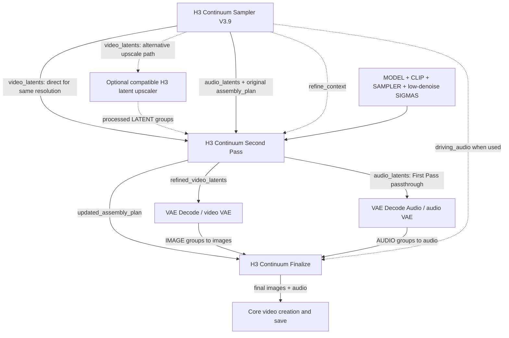

# Second Pass wiring guide — V3.9 / package 3.10.2

[日本語](SECOND_PASS_GUIDE_JA.md) · [README](../README.md)

Checked against the registered implementation in package 3.10.2 (2026-10-27).
This guide explains existing behavior; it does not introduce a new node, change
saved Takes or require changes to workflows that do not use Second Pass.

## What it does

**H3 Continuum Second Pass** refines First Pass video latents using a separately
supplied MODEL, CLIP, SAMPLER and low-denoise SIGMAS schedule. It does not include
an upscaler. Use it at the same resolution, or after a compatible external
upscaler. It returns the original First Pass audio LATENT objects unchanged.
Finalize may subsequently apply its normal audio-seam processing or Driving Audio.

This is separate from Review Retry/Continue. It does not overwrite the saved
First Pass Take. It is not a guaranteed cure for contrast drift or upscale artifacts.

## Connection diagram

Solid arrows are required data paths; dashed arrows show conditional/optional
connections. The two VAE decoders need their matching video/audio VAE inputs.

Choose **one** video route: direct or through the upscaler. These are not two
simultaneous inputs. `refine_context` has a different type from `assembly_plan`.

## Exact socket checklist

| Destination | Source / action |
| --- | --- |
| Second Pass `video_latents` | Sampler `video_latents`, directly or through a compatible processor |
| Second Pass `audio_latents` | Matching Sampler `audio_latents`; keep order and shapes |
| Second Pass `assembly_plan` | Original Sampler `assembly_plan`, matching those latent groups |
| Second Pass `refine_context` | Matching Sampler `refine_context`; connect to retain captured First/Last/Reference conditioning when valid |
| Second Pass `video_vae` | Matching video VAE when target-geometry adaptation needs image re-encoding |
| Second Pass `model`, `clip`, `sampler`, `sigmas` | Explicit Second Pass dependencies and refinement schedule |
| Second Pass `refine_seed` | Separate refinement base seed; runtime derives group seeds |
| Video decoder | Second Pass `refined_video_latents` and matching video VAE |
| Audio decoder | Second Pass `audio_latents` and matching audio VAE |
| Finalize `images`, `audio` | Corresponding decoded IMAGE/AUDIO groups |
| Finalize `assembly_plan` | **Second Pass `updated_assembly_plan`**, not the original plan |
| Finalize `driving_audio` | Preserve the existing Sampler connection when Driving Audio is used |

Sampler and Second Pass video/audio outputs are ComfyUI **lists of physical
groups**, not one flat video tensor. Core decoders map over these lists. An
external processor must preserve this behavior; do not combine groups into a
single batch or split a terminal merged group into separate logical chunks.

## Start with same-resolution refinement

1. Keep the working First Pass settings. Add the Second Pass branch to a copy of
   your workflow; preserve the original workflow and saved Take files.
2. Connect all matching latent/plan/context outputs from the same Sampler result.
   V3.9 produces refine context automatically; no extra capture switch is needed.
3. Supply Second Pass MODEL, CLIP, SAMPLER and a low-denoise SIGMAS schedule.
   The context is conditioning data, not an automatic restoration of the upstream
   MODEL or its LoRAs. Choose the Second Pass MODEL/LoRAs explicitly.
4. Connect refined video and unchanged audio through their decoders to Finalize,
   and replace that branch's Plan connection with `updated_assembly_plan`.
5. Inspect Second Pass `status`. When conditioning inheritance is intended,
   look for `conditioning_source=refine_context`; Reference routing reports
   `reference_inheritance=verified` when applicable.

For missing/incomplete or unavailable conditioning adaptation, the runtime can
report a **prompt-only fallback**. A typed but invalid/mismatched context can
instead fail validation. Connecting the cable alone does not prove inheritance.
Older saved data may not contain the required live context; do not edit manifests
or mark read-only Takes reusable to obtain it.

## SIGMAS and steps

The public `sigmas` socket controls refinement; there is no separate public
Second Pass Steps/denoise widget. Use the appropriate scheduler for your chosen
MODEL/LoRA. For example, Core **BasicScheduler** can produce a schedule using its
Steps and denoise controls; use its MODEL input consistently with Second Pass.
Use a low-denoise schedule for refinement rather than blindly copying the full
First Pass text-to-video schedule. Merely reducing Steps does not ensure low noise.

There is no universal recommended step count or denoise for every H3 checkpoint,
Turbo LoRA or upscaler. Internal Tail scheduling examples in historical documents
are not an additional socket/control on this public node. This guide introduces
no newly GPU-validated quality preset.

## Adding an external upscaler

- **Latent processing:** insert a processor compatible with H3 video LATENTs
  before Second Pass. A generic image-latent upscaler is not automatically compatible.
- **Pixel processing:** process each physical group as
  `video latent -> Video VAE Decode -> image upscaler -> compatible H3 Video VAE Encode -> Second Pass`.
  Preserve the groups and original temporal latent lengths through the round trip.
- Change only video spatial H/W; preserve B/C/T, group count/order, finite values,
  matching First Pass audio and the original input Plan. Use one common target
  size across groups. Smaller-than-source dimensions are rejected.
- Long Terminal Merge may combine two logical chunks into one larger physical
  group. It remains indivisible and may have a higher memory cost.

Second Pass updates output geometry in its returned Plan. Spatial enlargement
increases sampling/VAE memory use; a working First Pass does not guarantee that
an upscaled Second Pass will fit. Accepted refined video is retained on CPU,
but active sampling still needs GPU memory. Latent interpolation can produce
double outlines: see [Issue #27](https://github.com/ukr8b3g-cmyk/ComfyUI-H3-Continuum/issues/27).

## Review and version boundaries

- **V3.9:** a partial prefix or a middle-chunk Review output can inherit its own
  conditioning when the captured context is validated and projected onto the
  actual output groups. Keep latent lists, Plan and context from the same result.
  This does not generate missing chunks or complete the Run automatically.
- **V3.8:** partial Review context inheritance is not supported; complete the
  sequence first. Historical V3.8 instructions must not be read as a blanket V3.9 restriction.
- The public Second Pass node keeps ID `H3ContinuumSecondPassV35`; the `V35`
  suffix is a compatibility ID, not a requirement to install an old release.
- Experimental Hi-Res Fix / Selective Second Pass paths are separate from this
  standard public node. No all-in-one Hi-Res node is required for this wiring.

## Source and validation scope

Socket names, passthrough, validation and output-scope behavior were checked
against [node schema](../v3/second_pass_nodes.py), [runtime](../v3/second_pass.py),
[V3.9 Sampler](../v3/driving_nodes.py) and [output projection](../v3/nodes.py).
[External processing contract](V38_OPEN_INTEGRATION_CONTRACT.md) ·
[Historical illustrated explanation](README_HISTORY.md#1-second-pass-and-hi-res-fix).

This documentation update does not run generation, change Takes/workflows, or
claim new browser/GPU acceptance, performance, memory peaks or visual quality.
