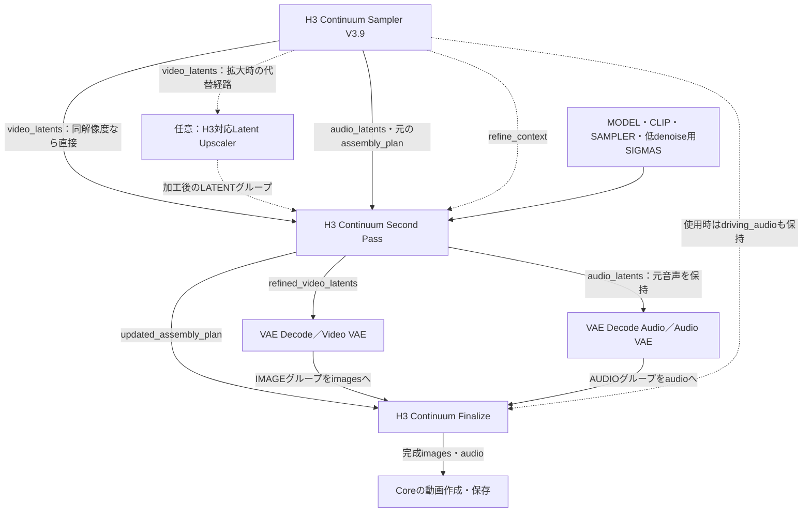

# Second Pass 接続ガイド — V3.9／パッケージ3.10.2

[English](SECOND_PASS_GUIDE.md) · [README](../README_JA.md)

2026-10-27、3.10.2の登録済み実装と照合した説明です。新機能の追加ではありません。
Second Passを使わない既存Workflowや、保存済みTakeを変更する必要はありません。

## 何をする機能か

**H3 Continuum Second Pass**は、First Passの映像latentを、別途入力した
MODEL・CLIP・SAMPLER・低denoise用SIGMASで再生成する機能です。
**拡大機能は内蔵していません。** 同じ解像度でのRefinementにも、対応する外部
Upscalerを通した後にも使えます。元のFirst Pass音声LATENTはそのまま返します。
その後のFinalizeでは、通常どおりAudio SeamやDriving Audioの処理が適用されます。

ReviewのRetry／Continueとは別の後段処理で、元の保存Takeを上書きしません。
コントラストのドリフトや拡大アーティファクトを必ず解消する機能ではありません。

## 接続図

実線は必要なデータ経路、破線は条件付き・任意の接続です。
映像・音声の各Decoderには、それぞれ対応するVAEも接続します。

映像の直接経路とUpscaler経路は**どちらか一方**を選びます。同時に2本を入力する図ではありません。
`refine_context`と`assembly_plan`は異なる型・役割です。

## ソケット別の接続表

| 接続先 | 接続元・役割 |
| --- | --- |
| Second Pass `video_latents` | Samplerの`video_latents`を直接、または対応する外部処理経由で接続 |
| Second Pass `audio_latents` | 同じSampler結果の元音声。順序・形状を維持 |
| Second Pass `assembly_plan` | その映像・音声に対応するSamplerの元Plan |
| Second Pass `refine_context` | 同じ結果のcontext。検証できたFirst／Last／Reference条件を継承 |
| Second Pass `video_vae` | 拡大先への条件適応で元画像の再Encodeが必要な場合、対応するVideo VAE |
| Second Pass `model / clip / sampler / sigmas` | Second Pass用に明示したモデル・テキストエンコーダー・Sampler・低denoise用スケジュール |
| Second Pass `refine_seed` | Refinement専用の基準Seed。区間ごとのSeedは内部で派生 |
| 映像Decoder | `refined_video_latents`と対応するVideo VAE |
| 音声Decoder | Second Passの`audio_latents`と対応するAudio VAE |
| Finalize `images / audio` | 対応する復号済みIMAGE／AUDIOグループ |
| Finalize `assembly_plan` | **Second Passの`updated_assembly_plan`**。元Planのままにしない |
| Finalize `driving_audio` | Driving Audio使用時は、既存のSampler接続を保持 |

映像・音声は、単一の平らなテンソルではなく**物理グループのリスト出力**です。
CoreのDecoderはリストを順に処理します。外部処理でもグループ構造を保ち、
全区間を1つのバッチへ結合したり、終端結合グループを論理チャンクへ分割したりしないでください。

## 最初は同じ解像度で確認する

1. 動いているFirst Passの設定を保持し、WorkflowのコピーにSecond Pass経路を追加します。
   元Workflowと保存Takeは残してください。
2. 同じSampler結果の映像・音声・Plan・contextを一組として接続します。
   V3.9はcontextを自動取得するため、追加のcaptureスイッチは不要です。
3. Second Pass用のMODEL・CLIP・SAMPLER・低denoise用SIGMASを接続します。
   contextは生成条件であり、First PassのモデルやLoRAを自動復元するものではありません。
   Second Passに使うモデル・LoRAはMODEL入力で明示します。
4. 処理後の映像と元音声をそれぞれDecodeし、Finalizeへ接続します。
   この経路のPlanは`updated_assembly_plan`へ差し替えます。
5. `status`を確認します。条件継承を意図した場合は
   `conditioning_source=refine_context`、Reference割当がある場合は
   `reference_inheritance=verified`が目安です。

context不足・未完了・条件適応不可の場合は、警告付きで**prompt-only fallback**に
なることがあります。一方、型付きcontextの破損や不一致は検証エラーになる場合があります。
ケーブルを接続しただけで継承成功とは判断しません。古い保存データには必要な実行時contextが
ない場合がありますが、manifestや読取専用フラグを手動変更して回避しないでください。

## SIGMAS・Stepsの考え方

公開Second Passノードには、独立したSteps／denoiseウィジェットはありません。
**外部の`sigmas`入力がスケジュールを決めます。** 使用モデル・LoRAに適した
Schedulerを選びます。例えばCoreの**BasicScheduler**ではStepsとdenoiseを設定して
SIGMASを作れます。そのMODEL入力もSecond Passと整合させます。
First Passの高ノイズから始めるスケジュールを、そのままコピーするのではなく、
Refinement向けの低denoiseスケジュールを用意します。Stepsを減らすだけでは低ノイズになりません。

全モデル・Turbo LoRA・Upscaler共通の推奨Steps／denoiseはありません。
履歴文書の内部Tailスケジュールは、この公開ノードに別のソケットや操作項目があるという意味では
ありません。本ガイドは、新しいGPU検証済み画質プリセットを提示するものではありません。

## 外部Upscalerを使う場合

- **latentで拡大：** H3の映像LATENTに対応した処理をSecond Pass前へ入れます。
  通常の静止画向けLatent Upscalerが、そのまま対応するとは限りません。
- **画像として拡大：** 物理グループごとに
  `映像latent → Video VAE Decode → 画像Upscaler → 対応するH3 Video VAE Encode → Second Pass`
  と接続します。往復でグループと時間方向のlatent長を維持する必要があります。
- 変更できるのは映像の空間サイズH/Wです。B/C/T、グループ数・順序、有限値、
  対応する元音声と入力Planを保持します。全グループを共通の出力サイズにそろえます。
  元より小さい空間サイズは拒否されます。
- Long Terminal Mergeでは、論理チャンク2個が1物理グループになる場合があります。
  分割できず、通常区間よりメモリ負荷が大きくなることがあります。

Second Passは出力Planの解像度を更新します。拡大でSampling／VAEのメモリ使用量が増えるため、
First Passが動いても同じ環境で拡大後の処理が収まる保証はありません。生成済み映像はCPUに
保持しますが、生成中のGPUメモリは別です。latent補間による二重輪郭は
[Issue #27](https://github.com/ukr8b3g-cmyk/ComfyUI-H3-Continuum/issues/27)の別課題です。

## Review・バージョンの違い

- **V3.9：** 途中までのReviewや中間Chunk単独でも、実出力グループに投影・検証できた
  contextから、その区間自身の条件を継承できます。同じ結果のlatent・Plan・contextを使います。
  未生成区間を自動生成したり、Run全体を完了にしたりする機能ではありません。
- **V3.8：** 途中Reviewのcontext継承には対応しません。先にシーケンスを完了します。
  旧V3.8の説明をV3.9全体の制約と混同しないでください。
- ノードIDは互換性のため`H3ContinuumSecondPassV35`を維持しています。
  `V35`という内部名は、旧版をインストールする必要があるという意味ではありません。
- ExperimentalのHi-Res Fix／Selective Second Passは、この標準ノードとは別です。
  この接続に一体型Hi-Resノードは必要ありません。

## 照合先と確認範囲

[ノード定義](../v3/second_pass_nodes.py)、[実行処理](../v3/second_pass.py)、
[V3.9 Sampler](../v3/driving_nodes.py)、[出力区間の投影](../v3/nodes.py)と照合しました。
[外部処理の仕様](V38_OPEN_INTEGRATION_CONTRACT.md) ／
[以前の画像付き説明](README_HISTORY.md#1-second-pass-and-hi-res-fix)。

今回は文書整備です。生成・保存Take・Workflowの変更は行わず、実ブラウザー／GPU受入、
速度・実VRAMピーク・画質の新しい合格を意味しません。
